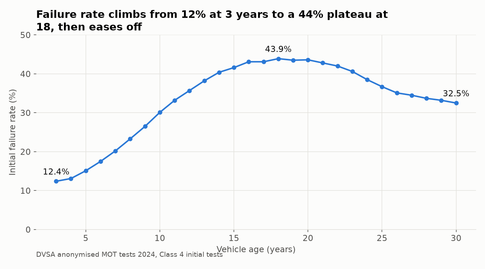
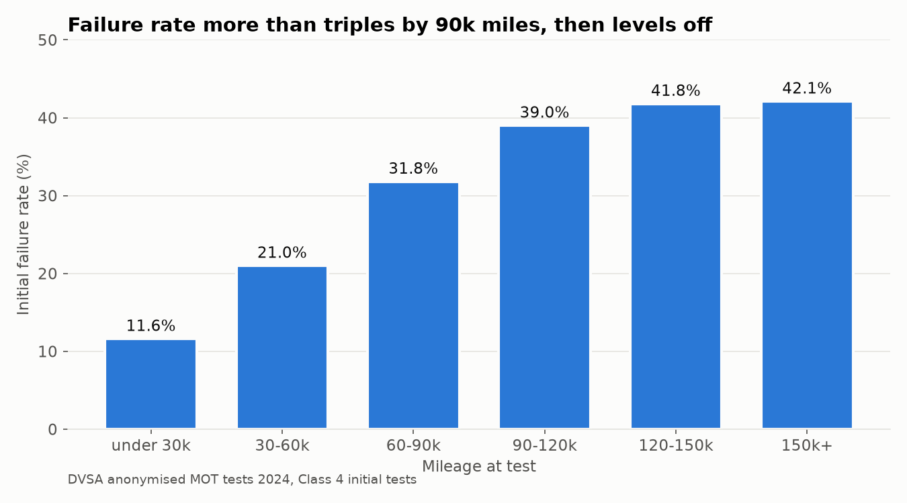
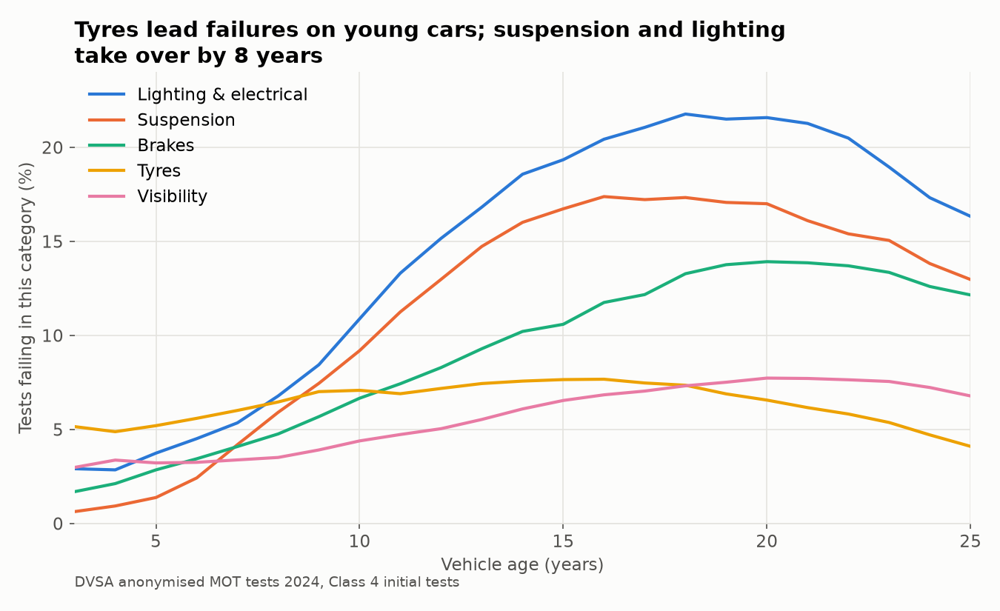
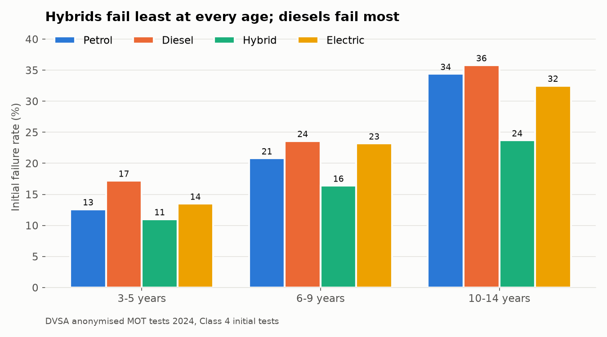
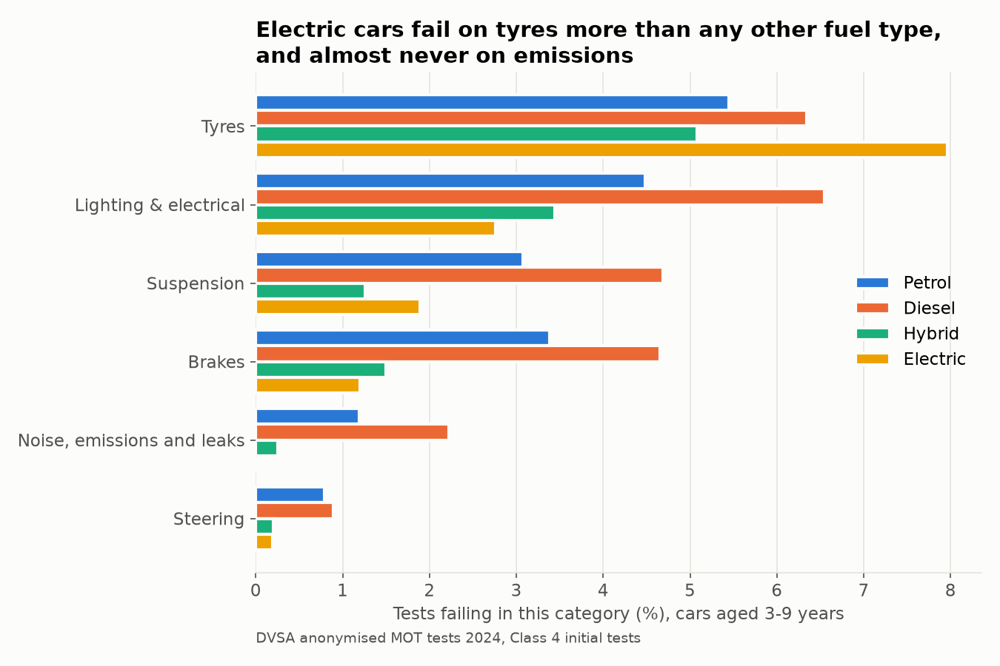
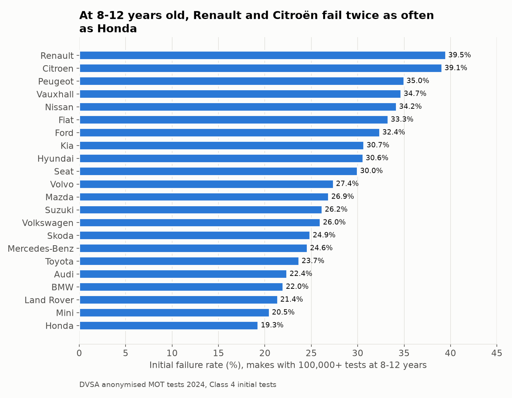

# What makes a car fail its MOT? An analysis of 33 million UK tests

An analysis of every MOT test carried out in Great Britain in 2024 (42 million tests and 92 million defect and advisory records from the DVSA), built with SQL in DuckDB and Python. I'm a mechanical engineer, so the questions are engineering ones: which systems wear out as cars age, and how failures differ between petrol, diesel, hybrid and electric cars.

**Scope of the numbers below:** cars and light vans (Class 4), initial tests only, results pass, fail or PRS (fixed within an hour). That's **32,968,239 tests**.

## Key findings

**1. 28.3% of cars fail their MOT first time.** 22.8% still fail after on-the-spot repairs. Both figures are in line with DVSA's published statistics, which confirms the cleaning hasn't distorted the data.

**2. The failure rate rises with age and peaks at 18 years, then falls.** It goes from 12.4% at 3 years to 43.9% at 18, then drops to 32.5% at 30. The likely reason is survivorship: a car still on the road at 25 is usually one somebody looks after.



**3. Mileage has the same shape.** The failure rate more than triples from under 30k miles (11.6%) to 90–120k (39.0%), then levels off at about 42%.



**4. Different systems fail at different ages.** On a 3-year-old car, tyres are the top cause of failure. They're a wear item that depends on the driver, not the car's age, so they stay flat at 5–8% throughout. The systems that do deteriorate with age overtake tyres by about 8 years: suspension rises 27-fold (0.6% to 17.3% of tests, as springs corrode and bushes and joints wear), lighting and electrical from 2.9% to 21.8%, and brakes from 1.7% to 13.9%.



**5. Hybrids fail least at every age, and diesels fail most.** Comparing within the same age band, so newer hybrid and electric fleets aren't flattered: at 3–5 years, 11.0% of hybrids fail, against 12.6% of petrol cars and 17.2% of diesels.



**6. Electric cars fail differently.** At 3–9 years, tyres are the only main category where electric cars fail more often than any other fuel type: 8.0% of tests, against 5.5% for petrol. That fits the engineering, since EVs are heavier and deliver instant torque. They almost never fail on emissions and leaks (0.01%), and they fail least on brakes (1.2%), probably because regenerative braking does much of the work.



**7. Make matters, even at the same age.** Among cars aged 8–12 years, Renault (39.5%) and Citroën (39.1%) fail about twice as often as Honda (19.3%). Lighting or suspension is the top failure category for almost every make. Audi (tyres) and Kia (brakes) are the exceptions.



## Caveats

- **Make comparisons only control for age.** Mileage, owner type and maintenance differ between makes and aren't adjusted for.
- **167,725 tests (0.4%) were excluded** because their records in the source files contradicted each other. A bias check on January found a fail rate of 29.4% for those tests, against 30.0% for the rest, so excluding them barely moves the overall rate.
- **The electric fleet is young.** Only 18,422 electric cars aged 10–14 were tested, and within the 3–9 band most EVs are 3–5 years old.
- **Some mileages and first-use years were set to missing** because they were placeholders or typing errors: 330,098 mileages, and about 30 first-use years such as 94 or 1012. The rules are in [the data dictionary](docs/data_dictionary.md), section 7.
- **These are associations, not causes.** The explanations above (survivorship, battery weight, regenerative braking) are hypotheses the data is consistent with, not ones it proves.

## Method

1. **Load.** 24 monthly CSV files (about 12 GB), all read as text into DuckDB. The files differ from the official user guide in several ways: they use commas rather than pipes, use backslash escapes, repeat the header row inside the files, and populate the "dangerous" marker the guide says is empty.
2. **Clean.** Exact duplicate rows are removed. Tests whose rows still disagree are recorded in their own table and excluded. Types are converted deliberately, and each cleaning rule is documented with the number of rows it affects.
3. **Label.** Each defect is joined through the DVSA lookup tables to its severity (dangerous, major or minor) and its top-level system (brakes, suspension and so on). 99.997% of items match.
4. **Analyse.** SQL with CTEs and window functions, using DVSA's own metric definitions. Comparisons hold age fixed wherever fleet age would otherwise distort them.
5. **Check.** Every table is reconciled against a count I already trust. The expected numbers are listed in [docs/instructions.md](docs/instructions.md), section 11.

| Notebook | What it does |
|---|---|
| [01_exploration](notebooks/01_exploration.ipynb) | First look at the raw files |
| [02_load_and_clean](notebooks/02_load_and_clean.ipynb) | Builds the clean results and item tables |
| [03_looksups](notebooks/03_looksups.ipynb) | Loads the lookups and labels each defect with its system |
| [04_analysis](notebooks/04_analysis.ipynb) | Analysis queries, findings and charts |

**Next:** a model that predicts initial failure from age, mileage, make and fuel type, and scripts that rebuild the whole pipeline with one command.

## Reproduce it

1. Download the 2024 "Anonymised MOT tests and results" files (results, failure items and lookup tables) from [data.gov.uk](https://www.data.gov.uk/) into `data/raw/`, and unzip them.
2. Set up the environment:
   ```
   python -m venv .mot
   source .mot/bin/activate
   pip install -r requirements.txt
   ```
3. Run the notebooks in order from inside `notebooks/`. They build `data/mot.duckdb` (about 21 GB).

**Data:** DVSA, Anonymised MOT tests and results, 2024. Contains public sector information licensed under the [Open Government Licence v3.0](https://www.nationalarchives.gov.uk/doc/open-government-licence/version/3/).

**Tools:** Python, DuckDB, pandas, matplotlib.
