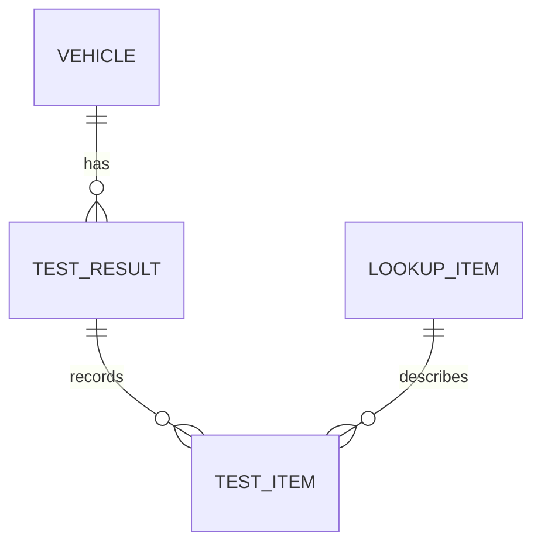
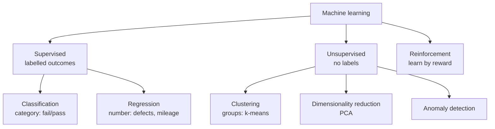
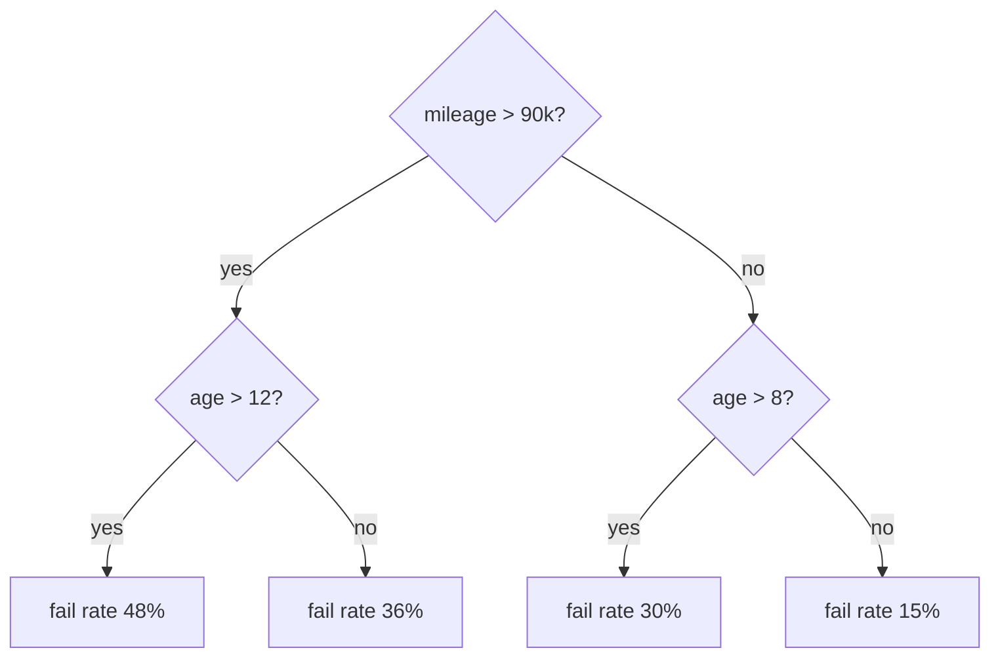
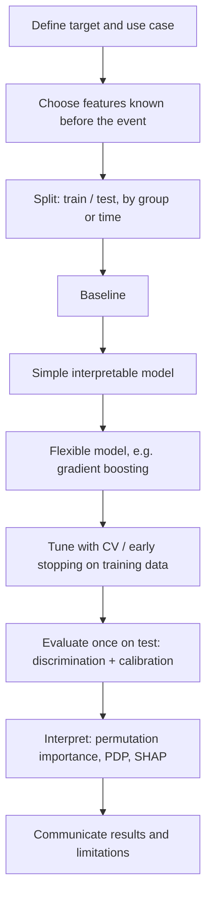

Project: [[MOT Data Analysis Project]]

Tags: [[comp-sci]], [[python]], [[personal-projects]], [[sql]], [[statistics]], [[cars]]
# Data Analysis Theory Handbook

A from-scratch reference for everything behind a project like the MOT 2024 analysis: the tools, the languages, the methods, the statistics and the modelling. Each section starts with the idea in plain words, then the detail, then how it showed up in this project.

> [!tip] How to use this note
> - Read a section top to bottom when learning it for the first time; jump to the **Glossary** (section 14) for a quick touch-up.
> - "In this project" boxes link the theory to what was actually done with the MOT data.
> - Maths uses LaTeX (`$...$`), which Obsidian renders. Diagrams use Mermaid, which Obsidian also renders.

## Contents

1. [[#1. The data analysis lifecycle]]
2. [[#2. Tools and environment]]
3. [[#3. Data fundamentals]]
4. [[#4. Databases and the relational model]]
5. [[#5. SQL from scratch]]
6. [[#6. Python from scratch]]
7. [[#7. NumPy and pandas]]
8. [[#8. Data cleaning and data quality]]
9. [[#9. Statistics for analysts]]
10. [[#10. Data visualisation]]
11. [[#11. Modelling foundations]]
12. [[#12. Model types and how they work]]
13. [[#13. Evaluating and explaining models]]
14. [[#14. Glossary]]
15. [[#15. Further reading]]

---

# 1. The data analysis lifecycle

## 1.1 The big picture

Almost every analysis project follows the same loop, whatever the tools. The best-known version is **CRISP-DM** (Cross-Industry Standard Process for Data Mining, 1999), and it is still the standard way to describe the work:


| Phase                  | The question you're answering                                         | Typical output                              |
| ---------------------- | --------------------------------------------------------------------- | ------------------------------------------- |
| Question understanding | What decision will this inform? What would a useful answer look like? | A short list of questions, success criteria |
| Data understanding     | What data exists, what does each column mean, how good is it?         | Data dictionary, first exploration notebook |
| Data preparation       | How do I turn raw files into trustworthy tables?                      | Cleaning pipeline, reconciliation counts    |
| Modelling / analysis   | What patterns, rates and relationships exist?                         | SQL queries, charts, models                 |
| Evaluation             | Are the results right, and do they answer the question?               | Sanity checks, held-out test scores         |
| Communication          | How do I explain it to someone who wasn't there?                      | README, report, portfolio page              |

Real projects loop back constantly. Discovering in the preparation phase that `test_id` isn't unique sends you back to data understanding.

> [!note] Rule of thumb
> Roughly 60–80% of the time in a real analysis goes on understanding and preparing data. That is normal, not a sign of doing it wrong.

## 1.2 Types of analysis

| Type | Question | Example from MOT data |
|---|---|---|
| **Descriptive** | What happened? | The 2024 initial fail rate for Class 4 cars |
| **Diagnostic** | Why did it happen? | Do diesels fail more because of fuel, or because they do more miles? |
| **Predictive** | What will happen? | The chance a given car fails its next MOT |
| **Prescriptive** | What should we do? | Which checks a garage should prioritise before a test |

Each step up needs more assumptions and more care. Descriptive results are facts about the data; predictive and prescriptive results are claims about the world.

## 1.3 Principles that run through everything

1. **Reproducibility.** Someone else (or you in six months) should be able to rerun everything from raw data and get the same numbers. That means code, not manual edits; pinned package versions; fixed random seeds.
2. **Reconciliation.** Every transformation should be checked against a number you already trust (row counts, totals, known rates).
3. **Documentation of decisions.** Every cleaning rule is a decision. Write down what, why and how many rows it touched.
4. **Data over documentation.** Official documentation is a claim about the data. The data itself is the evidence.
5. **Small steps.** Build and check one piece at a time; a bug found early costs minutes, a bug found late costs days.

> [!example] In this project
> The `sql/01…08` pipeline is the reproducible version; `src/load_db.py` reruns it and prints reconciliation counts that must match `docs/instructions.md` section 11. The data dictionary records every cleaning rule with its row counts.

---

# 2. Tools and environment

## 2.1 The terminal (shell)

**What it is:** a text interface to the operating system. You type commands, it runs programs. On macOS the default shell is **zsh**; on Linux it's often **bash**. Both follow the same basic rules.

**Core ideas:**
- **Working directory**: the folder you're "in". Relative paths are resolved from here.
- **Absolute path**: starts at the root, e.g. `/Users/me/project/data`. **Relative path**: from the working directory, e.g. `../data`. `.` is the current folder, `..` is the parent, `~` is your home folder.
- **Commands take arguments and flags**: `ls -la data/` runs `ls` with flags `-l` (long) and `-a` (all) on the argument `data/`.
- **Quoting**: paths with spaces need quotes: `cd "MOT testing data results (2024)"`.
- **Environment variables**: named values the shell passes to programs, e.g. `PATH` (where to look for programs).
- **Pipes** `|` send one command's output into another: `head -5 file.csv | cut -d, -f1`.
- **Redirection**: `>` writes output to a file (overwrites), `>>` appends.

| Command | What it does |
|---|---|
| `pwd` | Print working directory |
| `ls`, `ls -la` | List files (with details/hidden files) |
| `cd folder`, `cd ..` | Change directory / go up one |
| `mkdir -p a/b` | Make folders (and parents) |
| `cp`, `mv`, `rm` | Copy, move/rename, delete (no recycle bin!) |
| `head -n 5 f`, `tail -n 5 f` | First/last lines of a file |
| `wc -l f` | Count lines |
| `du -sh folder` | Disk usage |
| `which python` | Which program a command resolves to |

> [!warning] Big files
> Never open a multi-GB CSV in Excel or a text editor. Use `head`, or query it with DuckDB. Excel also silently truncates at 1,048,576 rows.

## 2.2 Python

**What it is:** a general-purpose, interpreted, dynamically typed programming language. "Interpreted" means you run code without a separate compile step; "dynamically typed" means variables don't declare their type in advance.

**Why analysts use it:** a huge ecosystem of data libraries (pandas, NumPy, scikit-learn, matplotlib), readable syntax, and it glues everything together (files, databases, web APIs, charts).

**Versions:** Python 3.x. Each minor version (3.12, 3.13, 3.14…) adds features; packages need to support your version. Python 2 is dead.

**How code runs:**
- A **script** (`.py` file) runs top to bottom: `python src/load_db.py`.
- A **notebook** (`.ipynb`) runs cell by cell in a **kernel** (a live Python process that remembers variables between cells).
- The **REPL** (type `python` in the terminal) runs one line at a time.

Section 6 covers the language itself.

## 2.3 Virtual environments and packages

**The problem:** different projects need different package versions. Installing everything globally creates conflicts ("dependency hell").

**The solution:** a **virtual environment** is a folder containing its own Python interpreter and its own installed packages. Activate it and `python`/`pip` point to that folder.

```bash
python -m venv .mot            # create (here the env is called .mot)
source .mot/bin/activate       # activate (Windows: .mot\Scripts\activate)
pip install pandas duckdb      # install into this env only
pip freeze > requirements.txt  # record exact versions
pip install -r requirements.txt  # recreate on another machine
deactivate                     # leave the env
```

- **pip** is Python's package installer; it downloads from **PyPI** (the Python Package Index).
- **requirements.txt** pins exact versions (`pandas==3.1.1`) so the environment is reproducible.
- Other tools you'll meet: **conda** (manages Python and non-Python dependencies), **uv** and **poetry** (faster/more structured alternatives to pip).
- **Semantic versioning**: `MAJOR.MINOR.PATCH`. A major version bump may break your code; minor adds features; patch fixes bugs.

## 2.4 Git and GitHub

**Git** is a **version control system**: it records snapshots ("commits") of your project so you can see what changed, when and why, and go back.

**GitHub** is a website that hosts Git repositories, adds collaboration features (pull requests, issues) and acts as your public portfolio.

**Mental model:**


| Command | Meaning |
|---|---|
| `git init` / `git clone URL` | Start a repo / copy an existing one |
| `git status` | What's changed, what's staged |
| `git add file` / `git add .` | Stage changes |
| `git commit -m "message"` | Save a snapshot with a message |
| `git log --oneline` | History |
| `git diff` | Line-by-line changes not yet staged |
| `git push` / `git pull` | Send to / fetch from the remote |
| `git branch name`, `git switch name` | Create / move to a branch |
| `git restore file` | Throw away unstaged changes to a file |

**Key concepts:**
- **Commit**: a snapshot plus a message, author and a unique hash (e.g. `48ecbdc`).
- **Branch**: a movable pointer to a line of commits. `main` is the default. Feature branches let you work without disturbing `main`.
- **Merge / pull request (PR)**: bringing a branch's changes into another, usually after review.
- **`.gitignore`**: patterns Git should never track (raw data, the database, the virtual env, secrets). GitHub rejects files over 100 MB, and data rarely belongs in Git anyway.
- **Good commit messages** say *what* and *why* in the imperative: "Load and clean results table".

## 2.5 VS Code and Jupyter

**VS Code** is a code editor with extensions for Python, Jupyter and Git. It provides syntax highlighting, autocompletion, a debugger, an integrated terminal and a Git panel.

**Jupyter notebooks** (`.ipynb`) mix code cells, their outputs (tables, charts) and Markdown text. Ideal for exploration and explaining your reasoning.

**Notebook pitfalls (important):**
- **Hidden state:** the kernel remembers variables from cells you've since deleted or edited. A notebook that works for you may fail for others. **Fix:** regularly "Restart kernel and run all".
- **Out-of-order execution:** cell numbers `[5]` show run order. If they're not ascending, the saved outputs may not match the code.
- **Re-running side effects:** running an `INSERT` cell twice inserts twice. Make cells **idempotent** (same result however many times you run them), e.g. `CREATE OR REPLACE`.
- **Working directory:** a notebook's working directory is its own folder, so paths are relative to `notebooks/`.

**Notebooks vs scripts:** notebooks are for exploration and storytelling; scripts (`.py`) are for pipelines that must run reliably and headless. A mature project has both: notebooks to show the work, scripts to rebuild it.

Run a notebook headless: `jupyter nbconvert --to notebook --execute --inplace notebook.ipynb`.

## 2.6 DuckDB

**What it is:** an **embedded, in-process, columnar, analytical** SQL database.

- **Embedded / in-process**: no server to install; it's a library inside your Python process, and the whole database is a single file (`mot.duckdb`). Like SQLite, but built for analysis.
- **Columnar**: stores each column together rather than each row together (see 4.6). Aggregating one column over 42M rows only reads that column.
- **Analytical (OLAP)**: optimised for big scans, joins and aggregations, not for many tiny updates.
- **Vectorised execution**: processes batches of values at a time, using modern CPU features; uses all your cores.
- **Out-of-core**: can process data bigger than RAM by spilling to disk.
- **Reads files directly**: `SELECT * FROM read_csv('file.csv')` or `read_parquet(...)` with no import step. Globs (`*.csv`) read many files as one.
- **Integrates with pandas**: `con.sql("...").df()` returns a DataFrame; DuckDB can also query a DataFrame by name.

```python
import duckdb
con = duckdb.connect("../data/mot.duckdb")         # file-backed database
con.sql("SELECT COUNT(*) FROM test_result_clean").show()
n = con.sql("SELECT COUNT(*) FROM t").fetchall()[0][0]  # a Python value
df = con.sql("SELECT * FROM t LIMIT 1000").df()          # a pandas DataFrame
con.close()
```

**Concurrency rule:** one process can write to a DuckDB file at a time. A second notebook or script trying to open it will error until the first calls `con.close()`. `read_only=True` lets several readers share it.

**Alternatives you'll meet:** SQLite (embedded, row-based, transactional), PostgreSQL / MySQL (client-server, general purpose), Snowflake / BigQuery / Redshift / Databricks (cloud data warehouses), Polars (a fast DataFrame library similar in spirit to DuckDB).

## 2.7 The Python data stack at a glance

| Library | Role |
|---|---|
| **NumPy** | Fast n-dimensional arrays and maths. The foundation everything else builds on |
| **pandas** | DataFrames: labelled tables in memory, for manipulation and analysis |
| **DuckDB** | SQL over files and tables far bigger than pandas handles comfortably |
| **matplotlib** | The base plotting library: static, fully controllable charts |
| **Plotly** | Interactive charts (hover, zoom), good for HTML/web |
| **seaborn** | Statistical plotting on top of matplotlib (not used here, common elsewhere) |
| **SciPy** | Scientific maths: statistics tests, optimisation, distributions |
| **statsmodels** | Classical statistics: regression with p-values, time series |
| **scikit-learn** | Machine learning: preprocessing, models, evaluation, all with one API |
| **requests / httpx** | Downloading from the web |

---

# 3. Data fundamentals

## 3.1 Types of data

**Statistical types** (decide which methods and charts make sense):

| Type | Description | Examples | Valid operations |
|---|---|---|---|
| **Nominal** (categorical) | Labels with no order | Make, fuel type, colour | Count, mode, equality |
| **Ordinal** | Labels with an order but uneven gaps | Defect severity: advisory < minor < major < dangerous | Plus ranking, median |
| **Interval** | Numeric, equal gaps, no true zero | Temperature °C, calendar year | Plus differences, mean |
| **Ratio** | Numeric with a true zero | Mileage, engine cc, age | Plus ratios ("twice as many miles") |
| **Binary** | Two values | Pass/fail | A special nominal; its mean is a proportion |

Also: **discrete** (countable values: number of defects) vs **continuous** (any value in a range: mileage, effectively).

**Storage types** (how a computer holds them):

| Type | SQL | Python / pandas |
|---|---|---|
| Integer | `INTEGER`, `BIGINT` | `int`, `int64`, nullable `Int64` |
| Decimal | `DOUBLE`, `DECIMAL(p,s)` | `float`, `float64` |
| Text | `VARCHAR` / `TEXT` | `str`, `object`, `string` |
| Boolean | `BOOLEAN` | `bool` |
| Date / time | `DATE`, `TIMESTAMP` | `datetime64[ns]` |
| Categorical | `ENUM` | `category` |
| Missing | `NULL` | `None`, `NaN`, `NA`, `NaT` |

> [!warning] Floating point
> Computers store decimals in binary, so `0.1 + 0.2 == 0.30000000000000004`. Never compare floats with `==`; use a tolerance. Use `DECIMAL` for money.

> [!note] Identifiers are text, not numbers
> IDs, postcodes, phone numbers: never do maths on them, so store them as text or treat them as labels. Numeric storage loses leading zeros.

## 3.2 Tabular data and "tidy" data

A **table** has **rows** (records/observations) and **columns** (fields/variables). Hadley Wickham's **tidy data** principles:

1. Each variable is a column.
2. Each observation is a row.
3. Each type of observational unit is its own table.

The **grain** of a table is what one row represents ("one row per MOT test", "one row per defect on a test"). Always know the grain of every table; most analysis bugs come from mixing grains (e.g. counting tests in a table whose grain is defects).

**Wide vs long format:**

```
Wide:   make | fail_2023 | fail_2024        Long:  make | year | fail_rate
        FORD |   0.30    |   0.29                  FORD | 2023 | 0.30
                                                   FORD | 2024 | 0.29
```

Long is better for analysis and plotting; wide is better for human-readable reports. `pivot` goes long → wide; `melt`/`unpivot` goes wide → long.

## 3.3 File formats

| Format | What | Pros | Cons |
|---|---|---|---|
| **CSV** | Plain text, values separated by a delimiter | Universal, human-readable | No types, ambiguous quoting, large, slow |
| **TSV / pipe-delimited** | CSV with tab or `\|` | Fewer clashes with commas in text | Same as CSV |
| **JSON** | Nested key-value text | Handles nested data, APIs use it | Verbose, awkward for big tables |
| **Excel (.xlsx)** | Spreadsheet | Business users love it | Row limit, hidden formatting, type guessing |
| **Parquet** | Binary, columnar, compressed | Fast, small, keeps types | Not human-readable |
| **Database file** | e.g. `.duckdb`, `.sqlite` | Queryable, typed, indexed | Needs the right software |

**CSV in depth (where real-world data breaks):**
- **Delimiter**: the separator. Commas are common, but text fields can contain commas.
- **Quoting**: a field containing the delimiter is wrapped in a quote character: `"Smith, John"`.
- **Escaping**: how a quote *inside* a quoted field is written: doubled (`""`, the RFC 4180 standard) or backslash (`\"`). Get this wrong and rows split in the wrong places.
- **Header row**: the first row of column names. When files are concatenated, header rows may appear again mid-data.
- **Encoding**: how characters become bytes. **UTF-8** is the standard; older files may be Latin-1/Windows-1252. Wrong encoding shows as `é` instead of `é`.
- **Line endings**: `\n` (Unix) vs `\r\n` (Windows).
- **Null representation**: empty string, `NULL`, `NA`, `\N`… all just text in a CSV.

> [!example] In this project
> The user guide said the files were pipe-delimited; they were comma-delimited with backslash escaping, and contained repeated header rows and the literal text `'NULL'`. Hence the fixed reader: `read_csv(path, all_varchar=true, quote='"', escape='\', filename=true)` and `WHERE test_id <> 'test_id'`.

## 3.4 Type inference and why we "load as text first"

Readers like DuckDB's `read_csv` and pandas' `read_csv` guess each column's type by **sampling** some rows. If the sample says "integer" and row 30 million contains `'NULL'` or `'12A'`, the load fails or the value silently becomes missing.

The robust pattern is **ELT** (Extract, Load, Transform):

1. **Extract/Load** everything as text (`all_varchar=true`). Nothing can fail.
2. **Inspect** what the text actually contains.
3. **Transform** with explicit, deliberate casts (`TRY_CAST`), counting what fails to convert.

Versus classic **ETL** (transform before loading), ELT keeps the raw data available so any decision can be revisited.

## 3.5 Data size and performance intuition

| Rows | Comfortable tool |
|---|---|
| < 1M | Excel (just), pandas, anything |
| 1M – 50M | pandas with care; DuckDB/Polars easily |
| 50M – billions | DuckDB/Polars on a laptop, or a cloud warehouse |

Memory estimate: rows × columns × bytes per value. 42M rows × 15 columns × 8 bytes ≈ 5 GB in memory as numbers, much more as Python strings. That's why heavy lifting happens in DuckDB and only aggregated or sampled results come into pandas.

**Sampling** is a legitimate strategy for exploration and modelling: a random 5% of 42M is still 2M rows, more than enough to estimate most things precisely (see 9.4).

---

# 4. Databases and the relational model

## 4.1 What a relational database is

A **database** is an organised, persistent store of data. A **relational database** (Edgar Codd, 1970) stores data in **tables** (formally "relations") that relate to each other through shared key columns. You query it with **SQL**, a *declarative* language: you say *what* you want, and the database's **query optimiser** decides *how* to get it.

A **DBMS** (database management system) is the software: DuckDB, PostgreSQL, SQL Server, etc. A **schema** is the set of tables, columns and types (and, in some systems, a namespace grouping tables).

## 4.2 Keys

- **Primary key (PK)**: a column (or set of columns) that uniquely identifies each row. Must be unique and not null. E.g. `test_id` *should* be the PK of a test table.
- **Composite key**: a PK made of several columns, e.g. `(test_id, rfr_id, rfr_type_code)`.
- **Foreign key (FK)**: a column referencing another table's PK. `test_item.test_id` → `test_result.test_id`. Enforces **referential integrity** (no orphans) if declared.
- **Natural key**: has real-world meaning (registration plate). **Surrogate key**: an artificial ID (an auto-incrementing number or hash). Surrogates are stable; natural keys change (people change plates).
- **Candidate key**: any column set that could be a PK.

> [!example] In this project
> The guide implied `test_id` was unique; it wasn't. Some tests appear in more than one row, sometimes identical (duplicates, removed) and sometimes disagreeing (conflicts, excluded into `test_conflicts`). Checking key uniqueness (`COUNT(*)` vs `COUNT(DISTINCT test_id)`) is always one of the first tests to run.

## 4.3 Relationships and cardinality

| Relationship | Meaning | Example |
|---|---|---|
| One-to-one | Each A has at most one B | Test ↔ test certificate |
| One-to-many | Each A has many B; each B one A | Test → defect items; vehicle → tests |
| Many-to-many | Needs a "bridge" table | Students ↔ courses via enrolments |

Draw it as an **ER (entity-relationship) diagram**:



**Why cardinality matters:** joining a one-to-many relationship multiplies rows. Join tests (one row each) to items (many each) and every test now appears once per item. Sum a test-level column after that join and you'll over-count: the classic **fan-out** bug.

## 4.4 Normalisation

**Normalisation** organises tables to remove redundancy, so each fact is stored once.

- **1NF**: each cell holds one atomic value; no repeating groups ("defect1, defect2, defect3" columns).
- **2NF**: 1NF, and every non-key column depends on the *whole* key (matters for composite keys).
- **3NF**: 2NF, and non-key columns don't depend on other non-key columns. E.g. don't store `fuel_type_desc` in every test row; store `fuel_type` code and look the description up.

"The key, the whole key, and nothing but the key."

**Denormalisation** deliberately repeats data (pre-joined, wide tables) to make reading faster and simpler. Transactional systems normalise; analytical systems often denormalise.

## 4.5 Star schema (analytics modelling)

Data warehouses commonly use a **star schema**:
- **Fact table**: events or measurements, many rows, numeric measures plus foreign keys (each MOT test, each defect).
- **Dimension tables**: descriptive context, fewer rows (vehicle make/model, date, defect category, test centre).

Queries join the fact to dimensions and aggregate. A **snowflake schema** further normalises the dimensions.

## 4.6 OLTP vs OLAP, row vs column storage

| | OLTP (transactional) | OLAP (analytical) |
|---|---|---|
| Workload | Many small reads/writes ("book this MOT slot") | Few huge reads ("fail rate by make over 42M tests") |
| Storage | Row-oriented | Column-oriented |
| Examples | PostgreSQL, MySQL, SQLite | DuckDB, Snowflake, BigQuery |
| Design | Normalised | Often denormalised / star |

**Row storage** keeps all of a row's values together: great for fetching one whole record. **Column storage** keeps each column's values together: great for scanning a few columns over millions of rows, and compresses well because similar values sit next to each other.

## 4.7 Transactions and ACID

A **transaction** is a group of operations that succeed or fail together. **ACID**:
- **Atomicity**: all or nothing.
- **Consistency**: rules (constraints) always hold.
- **Isolation**: concurrent transactions don't see each other's half-done work.
- **Durability**: once committed, it survives crashes.

## 4.8 Indexes, views and materialisation

- **Index**: an auxiliary structure (often a B-tree) that makes finding specific rows fast, like a book's index. Vital in OLTP; less important in columnar OLAP engines, which use **zone maps** (min/max per block) to skip data instead.
- **View**: a saved query that behaves like a table but is recomputed each time it's used. Good for definitions you want to keep consistent (`analysis_scope`).
- **Table (materialised)**: results physically stored. Faster to query, but goes stale if sources change.
- **Materialised view**: a view whose results are stored and refreshed.

> [!example] In this project
> Cleaned data is materialised as tables (`test_result_clean`), because building them is slow and they're reused constantly. The analysis scope (Class 4, NT, P/F/PRS) is a **view**, so the definition lives in one place and isn't baked into the data.

---

# 5. SQL from scratch

SQL (Structured Query Language) is the standard language for relational data. Dialects differ slightly (DuckDB, PostgreSQL, SQL Server, BigQuery), but the core is the same everywhere.

## 5.1 Categories of SQL statements

| Category | Purpose | Statements |
|---|---|---|
| **DQL** (query) | Read data | `SELECT` |
| **DDL** (definition) | Define structure | `CREATE`, `ALTER`, `DROP` |
| **DML** (manipulation) | Change data | `INSERT`, `UPDATE`, `DELETE` |
| **DCL / TCL** | Permissions / transactions | `GRANT`, `BEGIN`, `COMMIT`, `ROLLBACK` |

## 5.2 The SELECT statement

```sql
SELECT   make, COUNT(*) AS tests, AVG(is_fail::INT) AS fail_rate   -- 5
FROM     test_result_clean                                         -- 1
WHERE    test_class_id = '4'                                       -- 2
GROUP BY make                                                      -- 3
HAVING   COUNT(*) >= 1000                                          -- 4
ORDER BY fail_rate DESC                                            -- 6
LIMIT    10;                                                       -- 7
```

**Logical order of execution** (not the order you write it):

1. `FROM` / `JOIN`: gather the rows
2. `WHERE`: filter individual rows
3. `GROUP BY`: form groups
4. `HAVING`: filter groups
5. `SELECT`: compute output columns (window functions run here)
6. `DISTINCT`
7. `ORDER BY`: sort
8. `LIMIT` / `OFFSET`: cut

Consequences: you can't use a `SELECT` alias in `WHERE` in standard SQL (it doesn't exist yet), and you can't filter on an aggregate in `WHERE` (use `HAVING`). DuckDB relaxes some of these rules for convenience, but knowing the logical order explains most SQL errors.

## 5.3 Filtering

```sql
WHERE fuel_type IN ('PE', 'DI')
  AND test_mileage BETWEEN 0 AND 500000      -- inclusive both ends
  AND make LIKE 'MERC%'                       -- % = any chars, _ = one char
  AND model ILIKE '%golf%'                    -- case-insensitive (DuckDB/Postgres)
  AND first_use_date IS NOT NULL
  AND NOT is_unclassified
```

`AND` binds tighter than `OR`; always bracket mixed conditions: `WHERE a AND (b OR c)`.

## 5.4 NULL and three-valued logic

`NULL` means "unknown/missing". It is not zero, not an empty string, and not equal to anything, **including another NULL**.

- `NULL = NULL` → `NULL` (unknown), not `TRUE`. Use `IS NULL` / `IS NOT NULL`.
- SQL logic has three values: TRUE, FALSE, UNKNOWN. `WHERE` keeps only TRUE rows, so `WHERE x <> 'A'` silently **drops NULL rows**.
- Aggregates ignore NULLs: `AVG(x)` averages non-null values; `COUNT(x)` counts non-null; `COUNT(*)` counts rows.
- `x NOT IN (subquery)` returns nothing if the subquery contains a NULL. Prefer `NOT EXISTS`.
- `COALESCE(a, b, c)` returns the first non-null. `NULLIF(a, b)` returns NULL if a = b (handy: `NULLIF(col, 'NULL')` turns the text `'NULL'` into a real NULL).
- `IS DISTINCT FROM` is a NULL-safe `<>`.

## 5.5 Expressions and functions

```sql
CASE
    WHEN test_result = 'P' THEN 'pass'
    WHEN test_result IN ('F', 'PRS') THEN 'fail'
    ELSE 'other'
END AS outcome

CAST(x AS INTEGER)       -- errors if x can't convert
TRY_CAST(x AS INTEGER)   -- NULL if x can't convert (DuckDB; SQL Server: TRY_CONVERT)
x::INTEGER               -- shorthand cast (DuckDB/Postgres)

UPPER(s), LOWER(s), TRIM(s), LENGTH(s), SUBSTRING(s, 1, 3), REPLACE(s, 'a', 'b')
s1 || s2                 -- concatenate
regexp_matches(s, '^[A-Z]+$'), regexp_replace(s, '\s+', ' ', 'g')

date_diff('year', first_use_date, test_date)
date_trunc('month', test_date), EXTRACT(year FROM test_date)
ROUND(x, 2), ABS(x), LN(x), FLOOR(x), GREATEST(a, b), LEAST(a, b)
```

**Integer division trap:** in many dialects `1 / 2 = 0`. Cast first (`1.0 / 2`) or use `AVG` of a 0/1 column for rates.

## 5.6 Aggregation

```sql
SELECT make,
       COUNT(*)                               AS tests,
       COUNT(DISTINCT vehicle_id)             AS vehicles,
       SUM(CASE WHEN failed THEN 1 ELSE 0 END) AS fails,
       AVG(failed::INT)                       AS fail_rate,    -- mean of 0/1 = proportion
       COUNT(*) FILTER (WHERE failed)         AS fails_v2,     -- FILTER clause
       MEDIAN(test_mileage), quantile_cont(test_mileage, 0.9),
       MIN(test_date), MAX(test_date), STDDEV(test_mileage)
FROM ...
GROUP BY make;
```

Rule: every column in `SELECT` is either in `GROUP BY` or inside an aggregate. `GROUP BY ALL` (DuckDB) groups by every non-aggregated column. `ROLLUP`, `CUBE` and `GROUPING SETS` give subtotals.

## 5.7 Joins

A join matches rows from two tables using a condition (usually equal keys). Picture two overlapping circles of keys (a Venn diagram): the join type decides which parts you keep.

| Join | Keeps |
|---|---|
| `INNER JOIN` | Rows with a match in both tables |
| `LEFT JOIN` | All left rows; right columns NULL where no match |
| `RIGHT JOIN` | All right rows (just a mirrored LEFT; rarely used) |
| `FULL OUTER JOIN` | All rows from both |
| `CROSS JOIN` | Every combination (rows × rows). Rarely what you want |
| `SEMI JOIN` / `WHERE EXISTS` | Left rows that have a match, without duplicating them |
| `ANTI JOIN` / `WHERE NOT EXISTS` | Left rows with **no** match (finding orphans) |
| Self join | A table joined to itself (e.g. a test to the same vehicle's previous test) |

```sql
SELECT t.test_id, i.rfr_id, l.rfr_desc
FROM test_result_clean AS t
JOIN test_item_clean    AS i ON i.test_id = t.test_id
LEFT JOIN lookup_item   AS l ON l.rfr_id = i.rfr_id;
```

**Join checklist:**
1. What's the grain of each side? Will the join fan out?
2. Is the key unique on the "one" side? (If not, it's many-to-many: row explosion.)
3. Count rows before and after. A LEFT JOIN onto a unique key must not change the row count.
4. Use an anti-join to count unmatched rows (orphans).
5. Putting a right-table condition in `WHERE` turns a LEFT JOIN into an INNER JOIN; put it in the `ON` clause instead.

## 5.8 Subqueries and CTEs

A **subquery** is a query inside another. A **CTE** (Common Table Expression, `WITH`) names a subquery so you can read the query top to bottom:

```sql
WITH initial AS (
    SELECT * FROM analysis_scope WHERE test_type = 'NT'
),
by_make AS (
    SELECT make, COUNT(*) AS n, AVG(is_initial_fail::INT) AS fail_rate
    FROM initial GROUP BY make
)
SELECT * FROM by_make WHERE n >= 10000 ORDER BY fail_rate DESC;
```

- **Scalar subquery**: returns one value: `WHERE mileage > (SELECT AVG(mileage) FROM t)`.
- **Correlated subquery**: references the outer query; runs per row conceptually; often replaceable with a join or window.
- **Recursive CTE**: for hierarchies (a defect section → subsection → item tree).

## 5.9 Window functions

A **window function** computes across a set of related rows *without collapsing them* (unlike `GROUP BY`). Syntax: `function() OVER (PARTITION BY ... ORDER BY ... frame)`.

```sql
SELECT vehicle_id, test_date, test_result,
       ROW_NUMBER() OVER (PARTITION BY vehicle_id ORDER BY test_date) AS nth_test,
       LAG(test_result) OVER (PARTITION BY vehicle_id ORDER BY test_date) AS previous_result,
       COUNT(*) OVER (PARTITION BY make)                AS make_tests,
       AVG(failed::INT) OVER ()                         AS overall_fail_rate,
       SUM(n) OVER (ORDER BY month ROWS BETWEEN 2 PRECEDING AND CURRENT ROW) AS rolling_3m
FROM ...;
```

| Function | Use |
|---|---|
| `ROW_NUMBER()` | 1, 2, 3… unique per partition (deduplication, "first test") |
| `RANK()` / `DENSE_RANK()` | Ties share a rank (RANK leaves gaps) |
| `NTILE(10)` | Split into deciles |
| `LAG()` / `LEAD()` | Previous / next row's value |
| `FIRST_VALUE()` / `LAST_VALUE()` | First/last in the window |
| `SUM/AVG/COUNT ... OVER` | Running totals, group totals alongside rows, shares of total |

**Deduplication pattern:**
```sql
SELECT * FROM raw
QUALIFY ROW_NUMBER() OVER (PARTITION BY test_id ORDER BY filename) = 1;  -- QUALIFY = WHERE for windows (DuckDB, Snowflake, BigQuery)
```

## 5.10 Set operations

- `UNION` combines rows and removes duplicates; `UNION ALL` keeps duplicates (faster, usually what you want).
- `INTERSECT`: rows in both. `EXCEPT`: rows in the first but not the second. Great for reconciliation ("which IDs are in raw but not in clean?").
- `SELECT DISTINCT` removes duplicate rows from a result.

## 5.11 Creating and changing data

```sql
CREATE OR REPLACE TABLE test_result_clean AS
SELECT TRY_CAST(test_id AS BIGINT) AS test_id, ... FROM results_dedup;

CREATE TABLE t (id BIGINT PRIMARY KEY, name VARCHAR NOT NULL);
INSERT INTO t SELECT ... ;          -- appends! running twice doubles the data
INSERT INTO t VALUES (1, 'a');
UPDATE t SET name = 'b' WHERE id = 1;
DELETE FROM t WHERE id = 1;
DROP TABLE IF EXISTS t;
CREATE OR REPLACE VIEW analysis_scope AS SELECT ... ;
ALTER TABLE t ADD COLUMN x INTEGER;
```

**Constraints** (`PRIMARY KEY`, `NOT NULL`, `UNIQUE`, `CHECK (x >= 0)`, `REFERENCES other(id)`) make the database enforce rules for you.

## 5.12 Writing good SQL

- One clause per line, consistent indentation, keywords in capitals.
- Meaningful aliases (`t` for tests, `i` for items), always qualify columns in joins.
- Build queries in CTE steps; check the row count of each step.
- `LIMIT` while developing; remove it for the real run.
- Comment the *why*: `-- PRS counts as a fail: a defect was found, even if fixed within the hour`.
- `EXPLAIN` / `EXPLAIN ANALYZE` show the plan and where time goes.

## 5.13 Parameters and SQL from Python

```python
con.execute("SELECT * FROM t WHERE make = ?", ["FORD"]).df()   # parameterised: safe
con.sql(f"SELECT * FROM t WHERE make = '{make}'")               # f-string: only for trusted values
```

**SQL injection**: building SQL from untrusted text lets an attacker run their own SQL. Parameters (`?`) prevent it. f-strings are fine for your own constants (table names, sample percentages) in a notebook.

---

# 6. Python from scratch

## 6.1 Values, variables and types

A **variable** is a name pointing at a value. Python figures out the type from the value.

```python
age = 12                 # int
mileage = 110_000.5      # float (underscores are just for readability)
make = "RENAULT"         # str
failed = True            # bool
nothing = None           # the "no value" value
type(age)                # <class 'int'>
int("42"), float("3.5"), str(42), bool(0)   # conversions
```

Operators: `+ - * /` (`/` always gives a float), `//` (floor division), `%` (remainder: `hash(id) % 100` buckets), `**` (power), comparisons `== != < <= > >=`, logic `and or not`, membership `in`.

## 6.2 Strings

```python
s = "Hello"
s.lower(), s.upper(), s.strip(), s.replace("l", "L"), s.split(","), s.startswith("He")
s[0], s[-1], s[1:4]               # indexing and slicing (0-based, end excluded)
f"{make} fails {rate:.1%}"        # f-string: inline values with formatting
f"{n:,}"                          # 1,234,567 thousands separator
r"C:\path\new"                    # raw string: backslashes are literal (vital for regex and escape='\')
"""multi
line"""                           # triple quotes
rf"""... {var} ... \ ..."""       # raw + f-string
```

## 6.3 Collections

| Type | Syntax | Ordered | Mutable | Use |
|---|---|---|---|---|
| **list** | `[1, 2, 3]` | yes | yes | Sequences |
| **tuple** | `(1, 2)` | yes | no | Fixed records; `fetchall()` returns a list of tuples |
| **dict** | `{"make": "FORD", "n": 3}` | yes (insertion) | yes | Key → value lookup |
| **set** | `{"PE", "DI"}` | no | yes | Unique items, fast membership |

```python
features = ["age", "mileage"]
features.append("make"); features[0]; len(features)
d = {"P": "pass"}; d["F"] = "fail"; d.get("X", "unknown"); d.keys(); d.items()
rows = con.sql("SELECT COUNT(*) FROM t").fetchall()   # [(42000000,)]
n = rows[0][0]                                        # first row, first column
```

## 6.4 Control flow

```python
if rate > 0.5:
    label = "high"
elif rate > 0.3:
    label = "medium"
else:
    label = "low"

for month in range(1, 13):           # 1..12
    path = f"test_result_2024{month:02d}.csv"

while not done:
    ...

squares = [x**2 for x in range(10) if x % 2 == 0]   # list comprehension
lookup = {code: desc for code, desc in pairs}         # dict comprehension
```

**Indentation is syntax** in Python: the indented block belongs to the `if`/`for`. Use 4 spaces.

## 6.5 Functions

```python
def fail_rate(fails: int, tests: int) -> float:
    """Return fails as a share of tests."""     # docstring
    if tests == 0:
        return float("nan")
    return fails / tests

fail_rate(30, 100)
fail_rate(tests=100, fails=30)                  # keyword arguments
def evaluate(name, p, digits=4): ...            # default argument
spline = lambda: make_pipeline(...)             # lambda: a tiny anonymous function
```

**Scope:** variables created inside a function are local to it. Functions should take inputs as arguments and return outputs, rather than modifying globals.

## 6.6 Modules, packages and imports

```python
import numpy as np                          # whole module with an alias
from sklearn.metrics import roc_auc_score   # one name from a module
from pathlib import Path
```

A **module** is a `.py` file; a **package** is a folder of modules. The **standard library** ships with Python (`os`, `pathlib`, `time`, `json`, `csv`, `re`, `datetime`, `math`, `random`, `argparse`, `zipfile`); everything else is installed with pip.

## 6.7 Errors and exceptions

```python
try:
    con = duckdb.connect(path)
except duckdb.IOException as e:
    print(f"Database is locked by another process: {e}")
finally:
    ...                              # runs whatever happens

assert n_clean == 41_987_123, "reconciliation failed"   # stop if a check fails
raise ValueError("bad input")
```

Read a **traceback** from the bottom up: the last line is the error type and message; lines above show where it happened.

## 6.8 Files and paths

```python
from pathlib import Path
root = Path("..") / "data" / "raw"
for f in sorted(root.glob("*.csv")): print(f.name, f.stat().st_size)
with open("out.txt", "w", encoding="utf-8") as fh:   # 'with' closes the file automatically
    fh.write("hello")
```

## 6.9 Scripts and command-line arguments

```python
import argparse
if __name__ == "__main__":          # only runs when executed, not when imported
    p = argparse.ArgumentParser()
    p.add_argument("--raw", default="data/raw")
    p.add_argument("--db", default="data/mot.duckdb")
    args = p.parse_args()
```

## 6.10 Objects, classes and methods (just enough)

Everything in Python is an **object** with **attributes** (data) and **methods** (functions attached to it): `df.shape` is an attribute, `df.head()` a method. A **class** is a blueprint for objects. scikit-learn models are classes: `model = LogisticRegression()` creates an object; `model.fit(X, y)` changes its internal state; `model.coef_` reads a learned attribute (trailing `_` means "learned from data").

**Method chaining** calls methods one after another, each returning a new object: `df.query("age > 3").groupby("make")["failed"].mean().sort_values()`.

## 6.11 Mutability and copies

Lists, dicts and DataFrames are **mutable**: two names can point to the same object, so changing one changes "both". `b = a` doesn't copy; `b = a.copy()` does. In pandas, modifying a slice can trigger `SettingWithCopyWarning`; use `.copy()` or `.loc` deliberately.

---

# 7. NumPy and pandas

## 7.1 NumPy

**NumPy** provides the **ndarray**: a fixed-type, contiguous block of numbers. Operations are **vectorised**: written once for the whole array and executed in fast C code instead of a slow Python loop.

```python
import numpy as np
a = np.array([1, 2, 3])
a * 2, a.mean(), a.std(), np.log1p(a), np.sqrt(a)
np.full(5, 0.3)                        # array of 0.3s (the baseline prediction)
np.where(a > 1, "big", "small")        # vectorised if/else
np.nan                                 # "not a number": float missing value
np.isnan(x), np.nanmean(x)
```

**Broadcasting:** arrays of different shapes combine by stretching size-1 dimensions (`matrix - row_means[:, None]`).

## 7.2 pandas core objects

- **Series**: a 1-D labelled array (one column).
- **DataFrame**: a 2-D table of Series sharing an **index** (row labels).
- **Index**: labels for rows (default 0, 1, 2…). Joins and alignment use it, which is powerful and occasionally surprising.

```python
import pandas as pd
df = con.sql("SELECT ...").df()       # from DuckDB
df = pd.read_csv("file.csv")
df.head(), df.tail(), df.shape, df.dtypes, df.info(), df.describe()
df["make"].value_counts()             # frequency table
df.isna().sum()                       # missing per column
```

## 7.3 Selecting and filtering

```python
df["age"]                       # one column (Series)
df[["age", "mileage"]]          # several columns (DataFrame)
df.loc[df["age"] > 10, ["make", "age"]]    # by label / boolean mask
df.iloc[0:5, 0:2]               # by position
df[(df["fuel"] == "Diesel") & (df["age"] > 10)]   # use & | ~ and brackets, not and/or
df.query("fuel == 'Diesel' and age > 10")
```

## 7.4 Transforming

```python
df["age_band"] = pd.cut(df["age"], bins=[0, 3, 7, 12, 20, 99])       # fixed bins
df["decile"] = pd.qcut(df["pred"], 10, labels=False) + 1              # equal-count bins
df = df.assign(log_miles=lambda d: np.log1p(d["mileage"]))
df["make"] = df["make"].astype("category")       # saves memory, models use it
df.rename(columns={"test_mileage": "mileage"})
df.sort_values("fail_rate", ascending=False)
df.drop_duplicates(), df.dropna(subset=["age"]), df.fillna({"engine_cc": 0})
df["make"].str.upper(), df["date"].dt.year       # string and date accessors
```

## 7.5 Grouping, reshaping and joining

**Split-apply-combine:** split rows into groups, apply a function to each, combine the results.

```python
df.groupby("make").agg(tests=("failed", "size"), fail_rate=("failed", "mean"))
df.pivot_table(index="age", columns="fuel", values="failed", aggfunc="mean")
df.melt(id_vars="make", var_name="year", value_name="rate")
pd.merge(left, right, on="test_id", how="left", validate="many_to_one")   # validate catches fan-out
pd.concat([df1, df2])
```

## 7.6 pandas vs SQL translation

| SQL | pandas |
|---|---|
| `SELECT a, b` | `df[["a", "b"]]` |
| `WHERE x > 1` | `df[df.x > 1]` |
| `GROUP BY g` + `AVG(x)` | `df.groupby("g")["x"].mean()` |
| `HAVING COUNT(*) > 10` | `.filter(lambda g: len(g) > 10)` or filter after `agg` |
| `ORDER BY x DESC` | `.sort_values("x", ascending=False)` |
| `LEFT JOIN` | `pd.merge(..., how="left")` |
| `ROW_NUMBER() OVER (PARTITION BY g ORDER BY t)` | `df.sort_values("t").groupby("g").cumcount() + 1` |
| `LAG(x)` | `df.groupby("g")["x"].shift(1)` |
| `UNION ALL` | `pd.concat` |

**When to use which:** do big filtering, joining and aggregating in SQL (DuckDB), bring the smaller result into pandas for final shaping, charts and modelling.

---

# 8. Data cleaning and data quality

## 8.1 Dimensions of data quality

| Dimension | Question | MOT example |
|---|---|---|
| **Completeness** | Are values missing? | `cylinder_capacity` missing for electric cars |
| **Validity** | Do values follow the rules/format? | Mileage negative or 9,999,999 |
| **Accuracy** | Do values reflect reality? | A 1990 first-use date on a 2023 model |
| **Consistency** | Do related values agree? | The same `test_id` with two different results |
| **Uniqueness** | Are there duplicates? | Duplicate test rows across files |
| **Timeliness** | Is it up to date? | 2024 data published in 2025 |
| **Integrity** | Do references resolve? | Item rows whose `test_id` has no test |

## 8.2 Profiling first

Before cleaning anything, **profile** each column: row count, distinct count, null count, min/max, most common values, string lengths, sample of weird values.

```sql
SUMMARIZE test_result_clean;    -- DuckDB: one-line profile of every column
SELECT col, COUNT(*) FROM t GROUP BY col ORDER BY 2 DESC LIMIT 20;
```

## 8.3 Duplicates

- **Exact duplicates**: identical rows. Usually from file overlaps or load errors. Remove with `DISTINCT` or `ROW_NUMBER() = 1`.
- **Key duplicates with conflicting values**: same ID, different data. You can't know which is right; options are to pick by a rule (latest file), or **exclude** the key entirely and record the count. Excluding is the honest default when the number is small.
- Always check: `COUNT(*)` vs `COUNT(DISTINCT key)`.

## 8.4 Missing data theory

Why data is missing matters more than how much:

| Mechanism | Meaning | Example | Consequence |
|---|---|---|---|
| **MCAR** (missing completely at random) | Missingness unrelated to anything | A random file corruption | Dropping rows loses precision but doesn't bias |
| **MAR** (missing at random) | Explained by *other observed* variables | Engine size missing mostly for electric cars | Can be handled using the other variables |
| **MNAR** (missing not at random) | Depends on the missing value itself | Very high mileages left blank deliberately | Dropping or imputing biases results |

**Handling options:**
- **Drop** rows (listwise deletion): simple, fine for small MCAR.
- **Impute**: fill with mean/median/mode, a model prediction, or a constant.
- **Missing-indicator**: impute *and* add a "was missing" flag, so a model can learn whether missingness itself is informative (used in this project's logistic regression).
- **Leave as NULL** and let methods handle it (tree models like `HistGradientBoostingClassifier` do this natively).
- Never encode missing as a real-looking value like `0` or `-1` without a flag; a model or average will treat it as real.

## 8.5 Outliers and invalid values

An **outlier** is an unusually extreme value. It may be an error (a typo, a unit mix-up, a placeholder like `999999`) or genuine (a high-mileage taxi).

Detection:
- **Domain rules** (best): mileage can't be negative; a car can't be first used after its test.
- **IQR rule**: outside $[Q_1 - 1.5\,IQR,\; Q_3 + 1.5\,IQR]$ where $IQR = Q_3 - Q_1$.
- **Z-score**: $|z| = |x - \bar{x}|/s > 3$ (assumes roughly normal data; bad for skewed data like mileage).
- **Percentiles**: look at the 0.1% and 99.9% tails.

Handling: correct if possible, set to NULL if clearly invalid, **cap/winsorise** (clip to a percentile), or keep and use robust methods (median, trees). Document each choice with counts.

## 8.6 Standardising values

- Trim whitespace, unify case (`UPPER(TRIM(make))`).
- Map variants to one label (`'MERCEDES'`, `'MERCEDES-BENZ'` → one value).
- Convert placeholder text (`'NULL'`, `''`, `'N/A'`) to real NULLs.
- Parse dates and numbers explicitly with `TRY_CAST`, then count the NULLs that the cast created versus those that were already there.

## 8.7 Reconciliation and data lineage

**Reconciliation** = proving the numbers flow correctly through the pipeline:

```
raw rows                       = sum of file row counts
− repeated header rows         = n removed
− exact duplicates             = n removed
− conflicting test_ids         = n excluded
= clean rows                   (must match, to the row)
```

**Lineage** = knowing where every table comes from (raw → dedup → clean → labelled → analysis). A diagram of the pipeline and a table of counts per step make the work auditable.

## 8.8 Documenting decisions: the data dictionary

A **data dictionary** records, per table and column: name, meaning, type, allowed values/codes, units, null meaning, source, and every cleaning rule with the rows affected. It is the single most useful document for anyone (including you) using the data later.

---

# 9. Statistics for analysts

## 9.1 Populations, samples and parameters

- **Population**: everything you want to know about (all UK cars). **Sample**: what you observed.
- **Parameter**: a true population value (the true fail rate $p$). **Statistic / estimate**: computed from data ($\hat{p}$).
- With MOT data you have (nearly) *every* test in 2024, so 2024 rates are almost population values. Uncertainty still matters for small groups (rare models), for comparisons, and for generalising to other years.

## 9.2 Descriptive statistics

**Centre:**
- **Mean** $\bar{x} = \frac{1}{n}\sum x_i$. Sensitive to outliers.
- **Median**: the middle value. Robust to outliers; better for skewed data (mileage, income).
- **Mode**: most common value (for categories).

**Spread:**
- **Variance** $s^2 = \frac{1}{n-1}\sum (x_i - \bar{x})^2$ (the $n-1$ is Bessel's correction for samples). **Standard deviation** $s = \sqrt{s^2}$, in the data's units.
- **Range**, **IQR** ($Q_3 - Q_1$, the middle 50%), **percentiles** (the 90th percentile: 90% of values are below it).

**Shape:**
- **Skewness**: asymmetry. Right-skewed (long tail to the right, mean > median): mileage, prices.
- **Kurtosis**: heaviness of tails.
- **Modality**: number of peaks.

**Proportions and rates:** for a 0/1 variable, the mean is the proportion. A **rate** needs a clear numerator and denominator: "fails per initial test" is not the same as "fails per vehicle" or "defects per test". Always state both.

## 9.3 Probability basics

- $P(A)$ between 0 and 1. $P(\text{not } A) = 1 - P(A)$.
- **Conditional probability** $P(A \mid B) = \frac{P(A \cap B)}{P(B)}$: "the fail rate *given* the car is diesel".
- **Independence**: $P(A \mid B) = P(A)$.
- **Bayes' theorem**: $P(A \mid B) = \frac{P(B \mid A)\,P(A)}{P(B)}$. Underlies naive Bayes and the base-rate fallacy (a 99%-accurate test for a rare thing still produces mostly false alarms).
- **Odds** $= \frac{p}{1-p}$. A 0.25 probability = odds of 1:3 = 0.333. Logistic regression works in **log-odds**.
- **Expected value** $E[X] = \sum x\,P(x)$: the long-run average.

## 9.4 Distributions

| Distribution | Describes | Example |
|---|---|---|
| **Bernoulli** | One yes/no trial with probability $p$ | One MOT test: fail or not |
| **Binomial** | Number of successes in $n$ trials | Fails among 1,000 tests |
| **Poisson** | Count of events in a fixed interval | Defects per test |
| **Normal (Gaussian)** | Symmetric bell curve, mean $\mu$, sd $\sigma$ | Measurement error; sample means |
| **Log-normal** | Variable whose log is normal; right-skewed | Mileage, prices |
| **Exponential** | Waiting times between events | Time until a component fails |
| **Uniform** | Every value equally likely | A good hash bucket |

**Normal rule of thumb (68–95–99.7):** about 68% of values lie within 1 sd of the mean, 95% within 2 (1.96 exactly), 99.7% within 3.

## 9.5 Sampling, the Law of Large Numbers and the Central Limit Theorem

- **Law of Large Numbers**: as the sample grows, the sample mean converges to the true mean.
- **Central Limit Theorem (CLT)**: the *mean* of a large sample is approximately normally distributed, whatever the shape of the underlying data. That's why normal-based confidence intervals work for proportions and means.
- **Standard error (SE)**: the standard deviation of an estimate across hypothetical repeated samples. For a mean: $SE = s/\sqrt{n}$. For a proportion: $SE = \sqrt{\hat{p}(1-\hat{p})/n}$.
- Precision improves with $\sqrt{n}$: four times the data halves the error. With 1.6M rows, a fail rate's SE is about 0.04 percentage points: tiny. With 200 tests of a rare model, it's about 3 points: large.

**Sampling methods:** simple random; **stratified** (sample within groups to guarantee coverage); **cluster** (sample whole groups, e.g. all tests of selected vehicles, as with `hash(vehicle_id) % 100` here); systematic (every k-th row, risky if the data has a pattern).

## 9.6 Confidence intervals

A **95% confidence interval** is a range built by a method that captures the true value in 95% of repeated samples. (Not "95% probability the true value is in this particular interval", strictly, though that's the practical reading.)

- **Normal (Wald) interval for a proportion**: $\hat{p} \pm 1.96\sqrt{\hat{p}(1-\hat{p})/n}$. Poor for small $n$ or $p$ near 0/1.
- **Wilson score interval**: better behaved for small samples and extreme rates; the default to use for fail rates of small groups.
- **Bootstrap**: resample your data with replacement many times, recompute the statistic each time, and take the 2.5th and 97.5th percentiles. Works for almost any statistic (medians, AUCs).

## 9.7 Hypothesis testing

The logic:
1. **Null hypothesis $H_0$**: no effect ("diesel and petrol fail rates are equal").
2. **Alternative $H_1$**: there is an effect.
3. Compute a **test statistic** from the data.
4. **p-value**: the probability of a result at least this extreme *if $H_0$ were true*.
5. If $p < \alpha$ (often 0.05), reject $H_0$.

| Error | Meaning | Controlled by |
|---|---|---|
| **Type I** (false positive) | Reject a true $H_0$ | Significance level $\alpha$ |
| **Type II** (false negative) | Miss a real effect | **Power** $= 1 - \beta$, grows with $n$ and effect size |

**Common tests:**

| Test | Compares | Example |
|---|---|---|
| **z-test / chi-squared for proportions** | Rates between groups | Diesel vs petrol fail rates |
| **Chi-squared test of independence** | Two categorical variables | Fuel type × result |
| **t-test** (Welch's) | Means of two groups | Mileage of passes vs fails |
| **ANOVA** | Means of 3+ groups | Mileage by fuel type |
| **Mann–Whitney U** | Two groups, non-parametric (ranks) | Skewed mileage |
| **Correlation tests** | Pearson / Spearman | Age vs mileage |

> [!warning] Significance is not importance
> With millions of rows, *everything* is statistically significant: a 0.1-point difference gets $p < 0.0001$. Focus on **effect size** (the size of the difference, with a confidence interval) and whether it matters in practice.

**Multiple comparisons:** test 100 makes at $\alpha = 0.05$ and you expect 5 false positives by chance. Corrections: **Bonferroni** (use $\alpha/m$), **Benjamini–Hochberg** (controls the false discovery rate). Or avoid "fishing": decide questions before looking.

**Effect sizes:** difference in proportions (percentage points), **relative risk** ($p_1/p_2$), **odds ratio**, Cohen's $d$ for means.

> [!note] Percentage points vs percent
> A rise from 20% to 30% is **10 percentage points** but a **50% relative** increase. Say which.

## 9.8 Correlation

- **Pearson's $r$**: strength of *linear* relationship, $-1$ to $1$. Sensitive to outliers.
- **Spearman's $\rho$**: correlation of ranks; captures any *monotonic* relationship; robust.
- $r = 0$ doesn't mean no relationship (a hump shape, like fail rate vs age, can have $r \approx 0$).
- **Anscombe's quartet**: four datasets with identical means, variances and correlations but completely different shapes. Always plot.

## 9.9 Correlation, causation and bias

Correlation doesn't imply causation. Common reasons a correlation isn't causal:

- **Confounding**: a third variable drives both. Diesels fail more, but diesels also do more miles; mileage confounds the fuel effect.
- **Reverse causation**: Y causes X.
- **Selection bias**: the sample isn't representative. Only cars that are still on the road get tested.
- **Survivorship bias**: you only see the survivors. Very old cars that still take MOTs are the well-kept ones, which is one explanation for the fail rate *falling* after about 18 years.
- **Simpson's paradox**: a trend in every subgroup reverses when groups are combined, because group sizes differ. Example: make A has a lower fail rate than make B at every age, but a higher one overall, because A's fleet is older.
- **Collider bias**: conditioning on a variable caused by both X and Y creates a fake association.

**Ways to get closer to causation:** randomised experiments (A/B tests); otherwise **stratification** (compare like with like: same age band and mileage band), **regression adjustment** (include confounders as variables), matching, natural experiments. A predictive model's feature importance is *not* a causal effect.

## 9.10 Regression to the mean and base rates

- **Regression to the mean**: extreme measurements tend to be followed by less extreme ones. The worst-performing make in a small sample will probably look better next year without anything changing.
- **Small-number noise**: the highest *and* lowest rates in a ranking are usually the smallest groups. Set a minimum group size and show intervals.
- **Base rate**: always compare against the overall rate. "Make X fails 35%" means little without "the average is 28%".

---

# 10. Data visualisation

## 10.1 Why and how charts work

A chart turns numbers into visual properties (position, length, colour) so the eye can spot patterns. **Cleveland & McGill** ranked how accurately people judge them, from best to worst:

1. Position on a common scale (dot plots, bar ends, line charts)
2. Position on non-aligned scales (small multiples)
3. Length (bars)
4. Angle / slope
5. Area (bubbles, pie slices)
6. Colour intensity / saturation

So: prefer bars, dots and lines; avoid pies with many slices, 3-D effects and area-based comparisons.

## 10.2 Choosing the chart

| Question | Chart |
|---|---|
| Compare categories | Horizontal bar (sorted), dot plot |
| Change over time / ordered x | Line chart |
| Distribution of one variable | Histogram, density, box plot, violin |
| Relationship between two numbers | Scatter (with transparency or hexbin for big data) |
| Part of a whole | Stacked bar (100%), or just a sorted bar |
| Two categories × a value | Heatmap |
| Many groups of the same chart | Small multiples (facets) |
| Model quality | ROC curve, calibration plot, residual plot |
| Feature importance | Sorted horizontal bar with error bars |

## 10.3 Design principles

- **One message per chart.** Put it in the title as a sentence: "Mileage and age drive the predictions; fuel type adds almost nothing".
- **Data-ink ratio** (Tufte): remove gridlines, borders and decoration that don't carry information.
- **Bars start at zero** (length encodes value). Lines and dots don't have to.
- **Sort categories** by value, not alphabetically, unless the order means something.
- **Label directly** instead of using a legend where possible.
- **Colour with purpose**: one highlight colour against grey; colour-blind-safe palettes; categorical palettes for categories, sequential for ordered values, diverging for above/below a midpoint.
- **Show uncertainty** (error bars, intervals) and **sample sizes** for small groups.
- **Source and scope** in a footnote ("DVSA MOT 2024, Class 4 initial tests").
- **Consistent style** across a project (same colours, fonts, sizes).

## 10.4 matplotlib anatomy

```python
fig, ax = plt.subplots(figsize=(8, 4.5))   # Figure = the canvas; Axes = one plot area
ax.barh(labels, values)
ax.set_title("..."); ax.set_xlabel("..."); ax.set_ylabel("...")
ax.xaxis.set_major_formatter(lambda v, _: f"{v:.0%}")
fig.tight_layout()
fig.savefig("../reports/figures/name.png", dpi=150)
```

Use the **object-oriented** interface (`fig, ax`) rather than `plt.plot` state for anything you'll customise. `plt.rcParams` sets project-wide defaults.

## 10.5 Exploratory vs explanatory

- **Exploratory charts** are for you: quick, many, ugly is fine.
- **Explanatory charts** are for an audience: few, polished, each answering one question.

## 10.6 Misleading-chart checklist

Truncated bar axes, dual y-axes implying a relationship, cherry-picked time windows, area/3-D distortion, unequal bin widths, missing denominators, colour scales that exaggerate small differences, averages hiding a bimodal distribution.

---

# 11. Modelling foundations

## 11.1 What a model is

A **model** is a simplified mathematical description of how an outcome relates to inputs: $y \approx f(X)$.

- $y$: the **target** / label / dependent variable / response (did the car fail?).
- $X$: the **features** / predictors / independent variables / covariates (age, mileage, make…).
- $f$: the function, with **parameters** learned from data (coefficients, tree splits).
- **Training / fitting**: choosing parameters so the model's predictions match known outcomes.
- **Inference / prediction**: applying the fitted model to new inputs.

"All models are wrong, but some are useful" (George Box). The aim is a model useful for a purpose: **prediction** (accurate forecasts) or **explanation** (understanding how inputs relate to the outcome). These pull in different directions: complex models predict better; simple models explain better.

## 11.2 Statistics vs machine learning

Same maths, different emphasis.

| | Classical statistics | Machine learning |
|---|---|---|
| Goal | Inference: is this effect real, how big? | Prediction on new data |
| Typical models | Linear/logistic regression, ANOVA | Trees, ensembles, neural networks |
| Validates with | p-values, confidence intervals, assumption checks | Held-out test data, cross-validation |
| Tools | statsmodels, R | scikit-learn, XGBoost, PyTorch |

## 11.3 Types of learning



- **Supervised**: you know the right answer for past examples and learn to predict it.
  - **Classification**: target is a category. **Binary** (fail/pass) or **multiclass** (which section fails).
  - **Regression**: target is a number (number of defects, repair cost). Note: *logistic regression* is a classification model despite its name.
- **Unsupervised**: find structure without a target (group similar vehicles, compress many defect columns into a few patterns).
- **Semi-supervised / self-supervised**: few labels, or labels made from the data itself (how large language models are pre-trained).
- **Reinforcement learning**: an agent learns actions by trial and reward (not relevant to typical analyst work).

Also: **time series forecasting** (predicting future values from past values) and **survival analysis** (predicting *time until* an event), see 12.11–12.12.

## 11.4 The learning problem: loss and optimisation

Training means minimising a **loss function** $L$ that measures how wrong predictions are:

| Loss | Formula | Used for |
|---|---|---|
| **Squared error** (MSE) | $\frac{1}{n}\sum (y_i - \hat{y}_i)^2$ | Linear regression |
| **Absolute error** (MAE) | $\frac{1}{n}\sum \lvert y_i - \hat{y}_i\rvert$ | Robust regression |
| **Log loss** (binary cross-entropy) | $-\frac{1}{n}\sum \big[y_i\ln\hat{p}_i + (1-y_i)\ln(1-\hat{p}_i)\big]$ | Logistic regression, boosting for classification |
| **Hinge loss** | $\max(0, 1 - y_i f(x_i))$ | Support vector machines |

**Optimisation** finds the parameters with the lowest loss.
- **Closed form**: linear regression has an exact solution (the "normal equations").
- **Gradient descent**: start somewhere, compute the **gradient** (direction of steepest increase of the loss), step the other way, repeat. Step size = **learning rate**. Too big overshoots; too small is slow.
- **Stochastic / mini-batch gradient descent**: use a random subset each step; scales to huge data (how neural networks are trained).
- Variants: L-BFGS (used by scikit-learn's `LogisticRegression`), Newton's method, Adam (neural nets).

## 11.5 Generalisation, overfitting and the bias–variance trade-off

The point of a model is to perform well on **new, unseen data** (generalise), not just on the data it was trained on.

- **Underfitting**: too simple to capture the pattern (a straight line through a hump-shaped age effect). High error on training *and* test data.
- **Overfitting**: so flexible it learns noise specific to the training data (memorising individual cars). Low training error, high test error.

```
error
  │\                         ╱ test error
  │ \                      ╱
  │  \______        ____╱
  │         ‾‾‾‾‾‾‾‾         ← sweet spot
  │ \___
  │     ‾‾‾‾‾‾‾‾‾‾‾‾‾‾‾‾‾‾‾‾  training error
  └──────────────────────────── model complexity
   underfit              overfit
```

**Bias–variance decomposition** of expected squared error:

$$E[(y - \hat{f}(x))^2] = \underbrace{\text{Bias}[\hat{f}(x)]^2}_{\text{too simple}} + \underbrace{\text{Var}[\hat{f}(x)]}_{\text{too sensitive to the sample}} + \underbrace{\sigma^2}_{\text{irreducible noise}}$$

- **Bias**: systematic error from wrong assumptions.
- **Variance**: how much the model would change if trained on a different sample.
- **Irreducible error**: randomness the features can't explain (service history, driving style, the tester). No model can beat it, which is why the MOT model tops out at AUC ≈ 0.69.

**Fighting overfitting:** more data, simpler models, **regularisation** (11.9), early stopping, ensembles (bagging), cross-validation to choose complexity.

## 11.6 Train, validation and test sets

| Set | Used for | Rule |
|---|---|---|
| **Training** | Fitting parameters | The model sees it |
| **Validation** | Choosing hyperparameters, early stopping, model selection | Used repeatedly, so it gets "used up" |
| **Test (hold-out)** | Final, unbiased estimate of performance | Touched **once**, at the end |

Typical splits: 60/20/20, 70/15/15, or 80/20 with cross-validation on the 80.

**How to split matters:**
- **Random split**: fine when rows are independent.
- **Group split**: when rows share an entity (several tests of the same car), keep each group entirely in one set. Otherwise the model can partly memorise the car and the test score is optimistic. That's why this project splits by `hash(vehicle_id)`.
- **Time split**: for forecasting, train on the past and test on the future. Never let the future leak into training.
- **Stratified split**: keep the class balance the same in every set (important for rare targets).

## 11.7 Cross-validation

**k-fold cross-validation**: split training data into $k$ folds (often 5); train on $k-1$, validate on the remaining one; rotate; average the $k$ scores. Gives a more reliable estimate than one split, and a spread (standard deviation) showing how stable the model is.

Variants: **stratified k-fold**, **group k-fold** (keeps groups together), **time series split** (expanding window), **leave-one-out** (k = n; expensive).

## 11.8 Data leakage

**Leakage** is when information that wouldn't be available at prediction time sneaks into training. It makes models look brilliant in testing and fail in reality. It's the single most common serious modelling mistake.

| Kind | Example |
|---|---|
| **Target leakage** | Using the number of defects found to predict failure (you only know defects *after* the test) |
| **Train–test contamination** | Fitting the scaler/imputer on all data before splitting; the same car in train and test |
| **Temporal leakage** | Using 2025 information to predict a 2024 outcome |
| **Proxy leakage** | A column that is effectively the answer (`test_result` text used to predict `is_fail`) |

Defences: ask "would I know this value *before* the event I'm predicting?" for every feature; split first, then fit all preprocessing on training data only (scikit-learn **Pipelines** do this automatically); be suspicious of scores that look too good.

> [!example] In this project
> Features are limited to what's known about the car *before* the test (age, mileage, make, fuel, engine size). Defect counts or items would be target leakage.

## 11.9 Regularisation

**Regularisation** adds a penalty for complexity to the loss, so the model prefers simpler solutions:

- **L2 / Ridge**: penalty $\lambda\sum\beta_j^2$. Shrinks coefficients towards zero smoothly; handles correlated features well.
- **L1 / Lasso**: penalty $\lambda\sum|\beta_j|$. Can shrink coefficients exactly to zero, so it also **selects features**.
- **Elastic net**: a mix of both.

$\lambda$ (in scikit-learn, `C = 1/λ` for logistic regression: smaller C = stronger regularisation) is a **hyperparameter**. Features must be on similar scales for the penalty to be fair, hence standardisation. In trees, regularisation means limits on depth, leaves, minimum samples per leaf, and learning rate.

## 11.10 Parameters vs hyperparameters

- **Parameters** are learned from data (coefficients, split points).
- **Hyperparameters** are set before training and control *how* learning happens (number of trees, learning rate, regularisation strength, number of spline knots).

**Tuning** hyperparameters: **grid search** (try every combination), **random search** (sample combinations; usually more efficient), **Bayesian optimisation** (e.g. Optuna; learns which regions look promising). Always tune on validation data or with cross-validation, never on the test set.

## 11.11 Feature engineering

**Features** are the inputs as the model sees them. Good features often matter more than the choice of algorithm.

**Numeric features:**
- **Scaling**: **standardisation** $z = (x - \mu)/\sigma$ (mean 0, sd 1) or **min–max** to [0, 1]. Needed for distance-based models (k-NN, SVM), regularised linear models and neural nets; trees don't care.
- **Transformations**: $\log(1 + x)$ (`np.log1p`) for right-skewed values (engine cc, mileage); square root; Box–Cox / Yeo–Johnson.
- **Binning**: turn a number into bands (age 0–3, 4–7…). Simple and robust but throws away detail.
- **Polynomials**: $x, x^2, x^3$ let a linear model bend, but behave wildly at the edges.
- **Splines**: piecewise polynomials joined smoothly at **knots**. A flexible, well-behaved way for linear models to fit curves like the hump in fail rate vs age (`SplineTransformer`).
- **Interactions**: $x_1 \times x_2$ (does mileage matter more for diesels?). Trees find these automatically; linear models need them added.

**Categorical features:**
- **One-hot encoding**: one 0/1 column per category (`make_FORD`, `make_TOYOTA`…). Standard for linear models. Drop one category or regularise to avoid perfect collinearity (the "dummy variable trap").
- **Rare category grouping**: group infrequent categories as `OTHER` (top 40 makes here) to avoid sparse, noisy columns.
- **Ordinal encoding**: map categories to integers. Fine for trees or genuinely ordered categories; misleading for linear models with unordered ones.
- **Target encoding**: replace a category with the mean target for that category. Powerful for high-cardinality columns (model), but must be done within cross-validation folds or it leaks.
- **Native categorical support**: some tree libraries (HistGradientBoosting, LightGBM, CatBoost) split on categories directly.

**Dates:** extract age, month, day of week; compute durations (days since first use).

**Missing values:** see 8.4: impute + indicator, or native handling.

**Feature selection:** remove useless or redundant features (domain knowledge, L1 regularisation, permutation importance, recursive elimination). Fewer features = simpler, faster, less overfitting, easier to explain.

**Multicollinearity:** strongly correlated features (age and mileage) make linear coefficients unstable and hard to interpret, even if predictions are fine. Check with correlations or the **VIF** (variance inflation factor).

## 11.12 scikit-learn's design

Every scikit-learn object follows the same API, which is why the library is easy to learn:

| Method | Does |
|---|---|
| `.fit(X, y)` | Learn from training data |
| `.predict(X)` | Predicted class or value |
| `.predict_proba(X)` | Predicted probabilities (classifiers); `[:, 1]` is the positive class |
| `.transform(X)` | Apply a learned transformation (scalers, encoders) |
| `.fit_transform(X)` | Fit then transform (training data only!) |
| `.score(X, y)` | Default metric |

**Transformers** change data (scalers, imputers, encoders); **estimators** make predictions. A **Pipeline** chains them so that `fit` fits every step on training data only and `predict` applies the same steps to new data: no leakage, no forgotten steps. A **ColumnTransformer** applies different steps to different columns.

```python
model = make_pipeline(
    ColumnTransformer([
        ("num", make_pipeline(SimpleImputer(strategy="median"), StandardScaler()), ["age", "mileage"]),
        ("cat", OneHotEncoder(handle_unknown="ignore"), ["make", "fuel"]),
    ]),
    LogisticRegression(max_iter=2000),
)
model.fit(X_train, y_train)
p = model.predict_proba(X_test)[:, 1]
```

`random_state=42` fixes randomness so results are reproducible.

## 11.13 Always start with a baseline

A **baseline** is the simplest possible prediction: the overall average (regression, or base rate for classification), the most common class, or a simple rule. Every model must beat it, and *how much* it beats it is the real result. In this project the baseline predicts the average fail rate for every car; gradient boosting improves its Brier score by 9%.

---

# 12. Model types and how they work

## 12.1 Linear regression

**Idea:** the outcome is a weighted sum of the features plus noise.

$$\hat{y} = \beta_0 + \beta_1 x_1 + \beta_2 x_2 + \dots + \beta_p x_p$$

- $\beta_0$ is the **intercept** (prediction when all features are 0); $\beta_j$ is the change in $\hat{y}$ for a one-unit increase in $x_j$, **holding the other features constant**.
- **Fitting:** **Ordinary Least Squares (OLS)** chooses the $\beta$s that minimise the sum of squared **residuals** ($y_i - \hat{y}_i$). Closed-form solution: $\hat{\beta} = (X^\top X)^{-1}X^\top y$.
- **Assumptions (for valid inference)**, remembered as **LINE**: **L**inearity, **I**ndependence of errors, **N**ormality of errors, **E**qual variance (homoscedasticity). Also: no perfect multicollinearity.
- **Diagnostics:** residuals vs fitted plot (should be a shapeless cloud), Q–Q plot (normality), leverage/Cook's distance (influential points).
- **Output:** coefficients with standard errors, p-values and confidence intervals (`statsmodels`), $R^2$.
- **Strengths:** fast, interpretable, the basis for most of statistics. **Weaknesses:** only straight-line relationships unless you engineer features (splines, interactions); sensitive to outliers.

Extensions: **multiple regression** (many features), **polynomial regression**, **ridge/lasso** (regularised), **GLMs** (below).

## 12.2 Logistic regression

**Idea:** for a yes/no outcome, model the **log-odds** as a linear function, then squash it into a probability between 0 and 1 with the **sigmoid (logistic) function**.

$$\text{logit}(p) = \ln\frac{p}{1-p} = \beta_0 + \beta_1 x_1 + \dots + \beta_p x_p$$

$$p = \sigma(z) = \frac{1}{1 + e^{-z}}, \quad z = \beta_0 + \sum \beta_j x_j$$

```
p
1 ┤                  ______
  │               _-‾
0.5┤            _/
  │         _-‾
0 ┤‾‾‾‾‾‾‾‾‾
  └──────────────────────── z (log-odds)
```

- **Fitting:** **maximum likelihood estimation**: choose $\beta$s that make the observed outcomes most probable. Equivalent to minimising **log loss**. No closed form; solved iteratively (L-BFGS, Newton).
- **Interpretation:** $\beta_j$ is the change in log-odds per unit of $x_j$. $e^{\beta_j}$ is the **odds ratio**: $e^{0.1} = 1.105$ means each extra unit multiplies the odds of failing by 1.105 (+10.5%).
- **Decision boundary:** predict "fail" when $p > $ threshold (default 0.5, but choose it for the use case, see 13.3). The boundary is linear in the features.
- **Calibration:** logistic regression tends to produce well-calibrated probabilities out of the box.
- **Multiclass:** **multinomial (softmax) regression**.
- **Strengths:** interpretable, fast, probabilistic, strong baseline. **Weaknesses:** linear in log-odds unless you add splines/interactions.

> [!example] In this project
> Logistic regression with splines on age and mileage reached AUC 0.687 vs 0.692 for gradient boosting: almost the same, and far easier to explain, which suggests the effects are mostly smooth and separate.

## 12.3 Generalised Linear Models (GLMs)

Linear and logistic regression are both **GLMs**: a linear predictor $\eta = X\beta$, a **link function** connecting $\eta$ to the mean of $y$, and an outcome distribution.

| Outcome | Distribution | Link | Model |
|---|---|---|---|
| Continuous | Normal | Identity | Linear regression |
| Binary | Binomial | Logit | Logistic regression |
| Count (defects per test) | Poisson | Log | Poisson regression |
| Overdispersed count | Negative binomial | Log | Negative binomial regression |
| Positive, skewed (cost) | Gamma | Log | Gamma regression |

**GAMs** (Generalised Additive Models) replace each $\beta_j x_j$ with a smooth function $f_j(x_j)$ (splines), keeping interpretability while allowing curves. Logistic regression with spline features, as used here, is effectively a GAM.

## 12.4 k-Nearest Neighbours (k-NN)

**Idea:** predict from the $k$ most similar training examples (majority vote for classes, average for numbers). "Similar" = a distance, usually Euclidean $\sqrt{\sum (x_j - x'_j)^2}$.

- No training step (it's "lazy"); prediction is slow on big data.
- Needs scaled features (otherwise mileage in tens of thousands swamps age in years).
- Small $k$ = flexible/overfit; large $k$ = smooth/underfit.
- Suffers from the **curse of dimensionality**: in many dimensions, everything is far from everything.

## 12.5 Naive Bayes

**Idea:** apply Bayes' theorem, "naively" assuming features are independent given the class:

$$P(\text{fail} \mid x_1, \dots, x_p) \propto P(\text{fail}) \prod_j P(x_j \mid \text{fail})$$

Very fast, works well for text classification (spam filters), but its probabilities are poorly calibrated because the independence assumption is rarely true.

## 12.6 Decision trees

**Idea:** repeatedly split the data with yes/no questions on one feature at a time, choosing the split that best separates the outcomes, until the groups (leaves) are pure enough. A prediction is the average outcome (or majority class) in the leaf.



- **Split criteria:** classification uses **Gini impurity** $1 - \sum_k p_k^2$ or **entropy** $-\sum_k p_k\log_2 p_k$ (via **information gain**: the reduction in impurity); regression uses reduction in squared error.
- **Greedy:** each split is chosen as best *right now*, not globally optimal.
- **Controls (regularisation):** `max_depth`, `min_samples_leaf`, `max_leaf_nodes`, pruning.
- **Strengths:** intuitive, handles mixed types, non-linearities and interactions automatically, no scaling needed. **Weaknesses:** a single tree is unstable (small data changes → different tree) and overfits; step-shaped predictions.

## 12.7 Ensembles: bagging and random forests

An **ensemble** combines many models into one, usually beating any single one.

**Bagging** (Bootstrap AGGregatING): train many trees, each on a bootstrap resample (random sample with replacement) of the data; average their predictions. Averaging reduces **variance**.

**Random forest** = bagging + at each split, consider only a random subset of features. This decorrelates the trees, so averaging helps even more.
- Few hyperparameters, hard to badly overfit, robust default.
- **Out-of-bag (OOB) score**: each tree didn't see ~37% of rows, giving a free validation estimate.
- Slower and larger than one tree; less interpretable.

## 12.8 Gradient boosting

**Idea:** build trees **sequentially**, each one correcting the errors of the ensemble so far. Boosting mainly reduces **bias**.

1. Start with a constant prediction (the base rate, in log-odds).
2. Compute the **residuals** (more precisely, the negative gradient of the loss with respect to the current predictions: "which way and how much should each prediction move?").
3. Fit a small tree to those gradients.
4. Add the tree's output, scaled by the **learning rate** $\eta$ (e.g. 0.1): $F_m(x) = F_{m-1}(x) + \eta\, h_m(x)$.
5. Repeat for $M$ trees.

$$F_M(x) = F_0 + \eta\sum_{m=1}^{M} h_m(x)$$

- **Key hyperparameters:** number of trees, learning rate (smaller = needs more trees but generalises better), tree size (`max_depth` / `max_leaf_nodes`), `min_samples_leaf`, L2 regularisation, subsampling.
- **Early stopping:** hold out a validation fraction and stop adding trees when the validation loss stops improving. Chooses the number of trees automatically.
- **Histogram-based** implementations (scikit-learn's `HistGradientBoostingClassifier`, LightGBM) bucket each feature into ~255 bins, which makes training on millions of rows fast and handles missing values natively.
- **Popular libraries:** XGBoost, LightGBM, CatBoost (best native categorical handling), scikit-learn HistGradientBoosting.
- **Strengths:** usually the most accurate model for **tabular data**; handles non-linearity, interactions, missing values. **Weaknesses:** more hyperparameters, can overfit without early stopping, less interpretable (needs SHAP/permutation importance).

> [!tip] Bagging vs boosting in one line
> Bagging: many deep trees in **parallel**, averaged → lower variance. Boosting: many shallow trees in **series**, each fixing the last → lower bias.

## 12.9 Support Vector Machines (SVM)

**Idea:** find the boundary (hyperplane) that separates the classes with the **widest margin**. The points on the margin are the **support vectors**. The **kernel trick** (RBF, polynomial) lets SVMs draw curved boundaries by implicitly mapping data into higher dimensions. Strong on small-to-medium, high-dimensional data; slow on millions of rows; needs scaling; probabilities aren't native.

## 12.10 Neural networks (overview)

**Idea:** layers of simple units ("neurons"). Each computes a weighted sum of its inputs plus a bias and passes it through a non-linear **activation function** (ReLU $\max(0, z)$, sigmoid, tanh). Stacking layers lets the network learn very complex functions.

- **Training:** **backpropagation** computes the gradient of the loss with respect to every weight using the chain rule; **gradient descent** (often Adam) updates the weights, over many **epochs** (passes over the data) in **mini-batches**.
- A logistic regression is a neural network with no hidden layer and a sigmoid output.
- **Architectures:** multilayer perceptron (MLP, for tabular), CNNs (images), RNNs/LSTMs (sequences), **transformers** (text and nearly everything else, the basis of large language models).
- **Regularisation:** dropout, weight decay, early stopping.
- For ordinary tabular business data, gradient boosting usually matches or beats neural nets with far less effort. Neural nets dominate images, audio and text.

## 12.11 Survival analysis

**Idea:** model the **time until an event** (a component failing, a car being scrapped), handling **censoring**: for many subjects the event hasn't happened yet when observation ends, so you only know "at least this long".

- **Survival function** $S(t) = P(T > t)$; **hazard** $h(t)$ = instantaneous event rate at $t$ given survival to $t$.
- **Kaplan–Meier estimator**: non-parametric survival curve.
- **Cox proportional hazards model**: regression on the hazard: $h(t \mid x) = h_0(t)\, e^{\beta^\top x}$; $e^{\beta_j}$ is a **hazard ratio**.
- **Weibull** models: a parametric choice familiar from reliability engineering (the "bathtub curve": infant mortality, random failures, wear-out).
- Ideal for engineering-style questions on MOT data across years: how long until a model's first suspension failure?

## 12.12 Time series

Data indexed by time, where order matters and observations depend on the past.

- **Components:** **trend**, **seasonality** (MOT volumes peak in March and September with new-plate months), **cycles**, **noise**. **Decomposition** separates them.
- **Stationarity:** constant mean and variance over time; many models need it (achieved by **differencing**).
- **Autocorrelation (ACF/PACF):** correlation of a series with its own past.
- **Models:** moving averages, exponential smoothing (Holt–Winters), **ARIMA/SARIMA**, Prophet, or gradient boosting with lag features.
- **Validation:** always forward in time (train on the past, test on the future); rolling-origin evaluation.

## 12.13 Unsupervised learning

**Clustering**: group similar observations without labels.
- **k-means**: choose $k$; assign each point to the nearest centre; move centres to the mean of their points; repeat. Minimises within-cluster squared distance. Needs scaling; assumes round, similar-sized clusters; choose $k$ with the **elbow method** or **silhouette score**.
- **Hierarchical clustering**: build a tree (dendrogram) by repeatedly merging the closest clusters.
- **DBSCAN**: density-based; finds arbitrarily shaped clusters and labels outliers as noise.
- **Gaussian mixture models**: soft (probabilistic) cluster membership.

**Dimensionality reduction**: compress many features into a few.
- **PCA** (Principal Component Analysis): finds new axes (principal components) that are linear combinations of the features, ordered by how much variance they explain. Uses the eigenvectors of the covariance matrix. Good for visualisation, removing collinearity and noise.
- **t-SNE / UMAP**: non-linear methods for 2-D visualisation of clusters (distances between clusters aren't meaningful).

**Anomaly detection**: isolation forests, one-class SVM, or simple z-score/IQR rules. Useful for spotting suspicious mileage readings or odd testers.

**Association rules** (market-basket analysis): "cars that fail on X also tend to fail on Y" with **support**, **confidence** and **lift**. Apriori algorithm. A natural fit for co-occurring defects.

## 12.14 Choosing a model: a cheat sheet

| Situation | Start with |
|---|---|
| Need to explain effects to non-technical people | Logistic / linear regression (with splines if curved) |
| Best accuracy on tabular data | Gradient boosting (HistGradientBoosting / LightGBM / XGBoost) |
| Robust default with little tuning | Random forest |
| Count outcome | Poisson / negative binomial GLM, or boosting with Poisson loss |
| Time until event, with censoring | Kaplan–Meier, Cox, Weibull |
| Forecast future values | Exponential smoothing, ARIMA, boosting with lags |
| Find groups | k-means (scaled numeric data), hierarchical |
| Images / text / audio | Neural networks (often pretrained) |

---

# 13. Evaluating and explaining models

## 13.1 Classification: the confusion matrix

For a binary classifier at a chosen threshold:

| | Predicted fail | Predicted pass |
|---|---|---|
| **Actually failed** | True Positive (TP) | False Negative (FN) |
| **Actually passed** | False Positive (FP) | True Negative (TN) |

| Metric | Formula | Question it answers |
|---|---|---|
| **Accuracy** | $\frac{TP+TN}{\text{all}}$ | How often is it right? (Misleading with imbalance) |
| **Precision** | $\frac{TP}{TP+FP}$ | When it predicts fail, how often is it right? |
| **Recall / sensitivity / TPR** | $\frac{TP}{TP+FN}$ | Of the real fails, how many did it catch? |
| **Specificity / TNR** | $\frac{TN}{TN+FP}$ | Of the real passes, how many did it clear? |
| **False positive rate** | $\frac{FP}{FP+TN} = 1 -$ specificity | How many passes were flagged wrongly? |
| **F1 score** | $2\cdot\frac{\text{precision}\cdot\text{recall}}{\text{precision}+\text{recall}}$ | Harmonic mean balancing the two |

> [!warning] The accuracy trap
> If only 5% of cases are positive, a model that always says "negative" is 95% accurate and completely useless. Always compare against the base rate.

## 13.2 Threshold-free ranking metrics

- **ROC curve**: plots TPR against FPR for every possible threshold.
- **ROC AUC**: area under it. Equals the probability that a randomly chosen positive is ranked above a randomly chosen negative. 0.5 = coin toss, 1.0 = perfect. Rough guide: 0.6–0.7 weak/modest, 0.7–0.8 fair, 0.8–0.9 good, > 0.9 excellent (or suspicious: check for leakage). Insensitive to class imbalance, which is both a strength and a weakness.
- **Precision–Recall curve / PR AUC (average precision)**: more informative than ROC when positives are rare, because it focuses on the positive class. The baseline is the positive rate, not 0.5.
- **Gini coefficient** (credit scoring) $= 2\times AUC - 1$.
- **Lift / gains charts**: how many more positives the top-scored X% contains than random selection. "The riskiest tenth fails 51.6%, six times the safest tenth" is a lift statement.

## 13.3 Choosing a threshold

A probability becomes a decision only at a **threshold**. The right threshold depends on **costs**: if missing a dangerous car is far worse than an unnecessary inspection, choose a low threshold (high recall, lower precision). Methods: maximise expected profit/cost, fix a minimum recall, or pick a point on the PR curve. Never assume 0.5.

## 13.4 Probability metrics and calibration

When predictions will be used as probabilities ("this car has a 31% chance of failing"), ranking isn't enough; the numbers must be right.

- **Log loss**: $-\frac{1}{n}\sum[y\ln\hat{p} + (1-y)\ln(1-\hat{p})]$. Punishes confident wrong predictions very heavily. Lower is better.
- **Brier score**: $\frac{1}{n}\sum(\hat{p}_i - y_i)^2$: mean squared error of probabilities. 0 is perfect. Easier to interpret than log loss.
- **Brier skill score**: $1 - \frac{\text{Brier}_\text{model}}{\text{Brier}_\text{baseline}}$: the fractional improvement over always predicting the base rate.
- **Calibration**: among cases predicted at 30%, about 30% should actually happen. Check with a **calibration (reliability) plot**: bin predictions (e.g. deciles), plot mean predicted vs actual rate; a calibrated model lies on the diagonal.
- **Fixing calibration**: **Platt scaling** (fit a logistic regression on the scores) or **isotonic regression**, on validation data (`CalibratedClassifierCV`). Oversampling or class weights break calibration.

**Discrimination vs calibration**: AUC measures whether the model ranks cases correctly; calibration measures whether the probabilities are honest. A model can be good at one and bad at the other.

## 13.5 Regression metrics

| Metric | Formula | Notes |
|---|---|---|
| **MAE** | $\frac{1}{n}\sum\lvert y-\hat{y}\rvert$ | In the target's units; robust to outliers |
| **MSE** | $\frac{1}{n}\sum(y-\hat{y})^2$ | Punishes big errors |
| **RMSE** | $\sqrt{\text{MSE}}$ | In the target's units |
| **$R^2$** | $1 - \frac{\sum(y-\hat{y})^2}{\sum(y-\bar{y})^2}$ | Share of variance explained vs predicting the mean; can be negative on test data |
| **MAPE** | $\frac{100}{n}\sum\left\lvert\frac{y-\hat{y}}{y}\right\rvert$ | Percentage error; breaks when $y \approx 0$ |

**Residual analysis:** plot residuals against predictions and each feature; patterns mean the model is missing structure.

## 13.6 Class imbalance

When one class is rare (fraud, dangerous defects):
- Use metrics that respect it (PR AUC, recall at fixed precision, log loss), not accuracy.
- Stratify splits.
- **Class weights** (`class_weight="balanced"`) make errors on the rare class cost more.
- **Resampling**: undersample the majority, oversample the minority, **SMOTE** (synthetic minority examples). Only ever on training data.
- Adjust the threshold rather than the data, where possible, to keep probabilities calibrated.

The MOT initial fail rate (about 30%) isn't severely imbalanced, so none of this was needed.

## 13.7 Interpreting models

**Global** (how the model behaves overall) vs **local** (why this one prediction).

- **Coefficients / odds ratios** (linear models): direct, but only comparable when features are on the same scale, and unstable with collinearity.
- **Impurity-based importance** (trees, `feature_importances_`): fast but biased towards high-cardinality and continuous features, and computed on training data.
- **Permutation importance**: shuffle one feature on *held-out* data and measure how much the score drops. Model-agnostic and honest about generalisation. Caveat: correlated features share credit (shuffle age and the model leans on mileage), so both can look less important than they jointly are.
- **Partial dependence plots (PDP)**: the average prediction as one feature varies, others held as observed. Shows the *shape* of an effect (the age hump). **ICE plots** show one line per observation, revealing interactions.
- **SHAP values** (Shapley additive explanations, from game theory): split each prediction into contributions from each feature that add up to (prediction − average prediction). Gives both local explanations and global summaries. `shap` library; TreeSHAP is fast for tree models.
- **Surrogate models**: fit a simple tree to the complex model's predictions to approximate its logic.

> [!warning] Importance is not causation
> "Mileage is the most important feature" means the *model relies on it* to predict, not that adding miles *causes* failure by that amount. Use 9.9 for causal claims.

## 13.8 Model comparison and honest reporting

- Compare models on the **same test set** with the **same metrics**, including the baseline.
- Report uncertainty (bootstrap a confidence interval for AUC) when differences are small.
- Prefer the simpler model when performance is close (**Occam's razor**): easier to explain, maintain and trust.
- State limitations: what the data doesn't contain, what population the model applies to (Class 4, 2024), and known biases.
- **Data drift / concept drift**: the world changes (new car types, rule changes), so models degrade over time and need monitoring and retraining.

## 13.9 Fairness and ethics (brief)

Models can encode bias present in historical data. Check performance across subgroups, avoid using protected characteristics (or proxies for them) unjustifiably, be transparent about how predictions are used, and respect data protection (the MOT data is anonymised; never try to re-identify vehicles or people).

## 13.10 The modelling workflow, end to end



---

# 14. Glossary

| Term | Meaning |
|---|---|
| **Aggregate** | A function that summarises many rows into one value (`COUNT`, `AVG`) |
| **AUC** | Area under the ROC curve; ranking quality, 0.5–1 |
| **Baseline** | The simplest prediction a model must beat |
| **Bias (model)** | Systematic error from over-simple assumptions |
| **Bias (sampling)** | Data unrepresentative of the population |
| **Bootstrap** | Resampling with replacement to estimate uncertainty |
| **Brier score** | Mean squared error of predicted probabilities |
| **Calibration** | Whether predicted probabilities match observed frequencies |
| **Cardinality** | Number of distinct values; or the 1:1 / 1:many nature of a relationship |
| **Categorical** | A variable whose values are labels |
| **CTE** | `WITH name AS (...)`: a named subquery |
| **Columnar storage** | Storing each column contiguously; fast for analytics |
| **Confounder** | A variable that affects both the cause and the outcome |
| **Cross-validation** | Rotating validation folds for a reliable performance estimate |
| **DataFrame** | pandas' in-memory table |
| **Data leakage** | Information unavailable at prediction time used in training |
| **Denormalised** | Data repeated across rows for read speed |
| **Early stopping** | Stopping training when validation performance stops improving |
| **ELT / ETL** | Load then transform / transform then load |
| **Encoding (characters)** | Mapping text to bytes, e.g. UTF-8 |
| **Encoding (features)** | Turning categories into numbers, e.g. one-hot |
| **Ensemble** | Combining many models |
| **Fan-out** | Row multiplication from joining to a "many" side |
| **Feature** | An input variable to a model |
| **Foreign key** | A column referencing another table's primary key |
| **Gradient descent** | Iteratively stepping parameters downhill on the loss |
| **Grain** | What one row of a table represents |
| **Hyperparameter** | A setting chosen before training |
| **Idempotent** | Gives the same result however many times it runs |
| **Imputation** | Filling in missing values |
| **Kernel (Jupyter)** | The live Python process behind a notebook |
| **Log-odds (logit)** | $\ln(p/(1-p))$ |
| **Log loss** | Cross-entropy loss for probabilities |
| **Loss function** | What training minimises |
| **NULL** | SQL's missing/unknown value |
| **OLAP / OLTP** | Analytical / transactional database workloads |
| **One-hot encoding** | One 0/1 column per category |
| **Overfitting** | Learning noise; good on training, bad on new data |
| **p-value** | Probability of data this extreme if the null hypothesis is true |
| **Parameter (model)** | A value learned from data |
| **Permutation importance** | Score drop when a feature is shuffled |
| **Pipeline** | Chained preprocessing + model fitted together |
| **Precision / recall** | Correctness of positive predictions / share of positives caught |
| **Primary key** | Column(s) uniquely identifying a row |
| **Random seed / `random_state`** | Fixes randomness for reproducibility |
| **Reconciliation** | Checking counts against a trusted number |
| **Regularisation** | Penalising complexity to reduce overfitting |
| **Residual** | Actual minus predicted |
| **Schema** | Structure of tables, columns and types |
| **Sigmoid** | $1/(1+e^{-z})$: maps any number to (0, 1) |
| **Spline** | Smooth piecewise polynomial used to fit curves |
| **Standard error** | Standard deviation of an estimate |
| **Stratify** | Keep group proportions equal across splits or samples |
| **Target** | The outcome a model predicts |
| **Tidy data** | One variable per column, one observation per row |
| **Underfitting** | Too simple to capture the pattern |
| **Variance (model)** | Sensitivity to the particular training sample |
| **Vectorised** | Operating on whole arrays at once, not in Python loops |
| **View** | A saved query that acts like a table |
| **Window function** | A calculation across related rows that keeps every row |

---

# 15. Further reading

**SQL and databases**
- DuckDB documentation (duckdb.org/docs): especially "SQL introduction", window functions and `read_csv`.
- *SQL for Data Analysis*, Cathy Tanimura.
- Mode's SQL tutorial and the SQLBolt interactive exercises.

**Python and pandas**
- *Python for Data Analysis*, Wes McKinney (pandas' creator); free online.
- The official Python tutorial (docs.python.org/3/tutorial).

**Statistics**
- *Practical Statistics for Data Scientists*, Bruce, Bruce & Gedeck.
- *The Art of Statistics*, David Spiegelhalter (intuition, causation, communicating risk).
- *OpenIntro Statistics* (free textbook).

**Machine learning**
- *An Introduction to Statistical Learning* (ISLP, with Python), James, Witten, Hastie, Tibshirani: free, the best first ML book.
- *Hands-On Machine Learning with Scikit-Learn, Keras and TensorFlow*, Aurélien Géron.
- scikit-learn user guide (scikit-learn.org): excellent explanations of each model and metric.
- *Interpretable Machine Learning*, Christoph Molnar (free online): permutation importance, PDP, SHAP.
- StatQuest (Josh Starmer) videos: clear visual explanations of trees, boosting, logistic regression, ROC.

**Visualisation**
- *Storytelling with Data*, Cole Nussbaumer Knaflic.
- *Fundamentals of Data Visualization*, Claus Wilke (free online).

**Causal inference**
- *The Book of Why*, Judea Pearl (concepts).
- *Causal Inference: The Mixtape*, Scott Cunningham (free online, practical).

**Engineering practice**
- *Pro Git* (free online, git-scm.com/book).
- "Tidy Data", Hadley Wickham (2014 paper).
