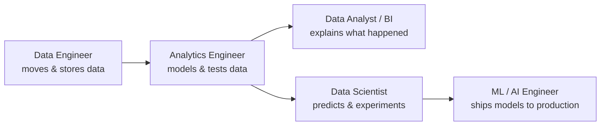
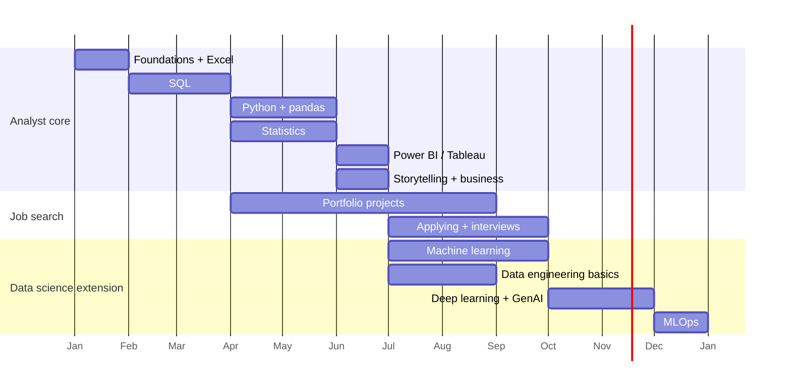

# Data Career Roadmap: from zero to hired

Everything you need to learn to go from no knowledge to landing a job in **data analysis** or **data science**, in the order to learn it, with the buzzwords you'll see in job adverts and hear in interviews. The theory behind most of this is in [[data_analysis_theory]].

> [!tip] How to use this note
> - Work through the phases in order. Phases 1–7 get you to a junior **data analyst** job; phases 8–11 add **data science** and **ML**.
> - Each phase ends with a `- [ ]` checklist. Tick items off in Obsidian as you learn them.
> - **Bold** terms are buzzwords: words recruiters search for, interviewers ask about, and you should be able to explain in one sentence.
> - The **Buzzword bingo** glossary at the end defines all of them.

## Contents

0. [[#0. The landscape: which data role?]]
1. [[#Phase 1. Foundations: maths, computers and mindset]]
2. [[#Phase 2. Spreadsheets]]
3. [[#Phase 3. SQL]]
4. [[#Phase 4. BI tools and dashboards]]
5. [[#Phase 5. Python for data]]
6. [[#Phase 6. Statistics and experimentation]]
7. [[#Phase 7. Business acumen, storytelling and soft skills]]
8. [[#Phase 8. Data engineering and the modern data stack]]
9. [[#Phase 9. Machine learning]]
10. [[#Phase 10. Deep learning and Generative AI]]
11. [[#Phase 11. MLOps and production]]
12. [[#Phase 12. Portfolio]]
13. [[#Phase 13. Getting the job]]
14. [[#Timeline and study plan]]
15. [[#Buzzword bingo: the glossary]]

---

# 0. The landscape: which data role?

"Data" is a family of jobs. They overlap heavily, and job titles mean different things at different companies, so always read the job description, not just the title.

| Role | What they do day to day | Core tools | Typical entry route |
|---|---|---|---|
| **Data Analyst** | Answer business questions with data; build reports and dashboards; track **KPIs** | SQL, Excel, Power BI/Tableau, some Python | Most accessible entry point |
| **Business Intelligence (BI) Analyst / Developer** | Build and maintain dashboards, **semantic layers**, reporting | Power BI (DAX), Tableau, SQL | Analyst with strong BI skills |
| **Product Analyst** | Measure how users use a product; **funnels**, **retention**, **A/B tests** | SQL, Amplitude/Mixpanel, Python, stats | Analyst in a tech company |
| **Analytics Engineer** | Turn raw data into clean, tested, documented models for analysts | SQL, **dbt**, Git, a **cloud data warehouse** | Analyst who loves pipelines |
| **Data Engineer** | Build the pipelines and infrastructure that move and store data | Python, SQL, Spark, Airflow, cloud (AWS/Azure/GCP) | Software or analytics engineering |
| **Data Scientist** | Statistics, **predictive modelling**, experiments, deeper analysis | Python, SQL, scikit-learn, stats | Analyst + ML, or a quantitative degree |
| **Machine Learning Engineer** | Put models into production and keep them running | Python, Docker, cloud, **MLOps** tools | Software engineering + ML |
| **AI Engineer** | Build products on **LLMs** (**RAG**, **agents**, **prompt engineering**) | Python, LLM APIs, **vector databases** | Software/ML engineering; the newest title |
| **Decision Scientist / Quant Analyst** | Optimisation, forecasting, risk, pricing | Python/R, stats, operations research | Maths, physics, engineering degrees |

**Analyst vs scientist in one line:** an analyst mostly explains *what happened and why* (**descriptive** and **diagnostic analytics**); a scientist mostly *predicts and tests* (**predictive** and **prescriptive analytics**, **experimentation**).

> [!note] Your edge as a mechanical engineer
> Engineering gives you things employers struggle to teach: quantitative thinking, problem decomposition, root-cause analysis, comfort with uncertainty and tolerances, reliability thinking (failure modes, the bathtub curve, **survival analysis**), and experience explaining technical work to non-specialists. Sell this as **domain expertise** and **transferable skills**. Target sectors that value it: manufacturing, automotive, aerospace, energy, utilities, engineering consultancies, insurance, **predictive maintenance** and **IoT** / sensor data.

---

# Phase 1. Foundations: maths, computers and mindset

## 1.1 Maths you actually need

**For analysts:**
- Arithmetic fluency: percentages, **percentage points vs percent**, ratios, rates, weighted averages, compound growth (**CAGR**), indexing to a base year.
- Basic algebra: rearranging formulas, linear relationships ($y = mx + c$).
- Descriptive statistics: mean, median, mode, standard deviation, percentiles (Phase 6).
- Basic probability.

**Additionally for data scientists:**
- **Linear algebra**: vectors, matrices, matrix multiplication, dot products, transposes; the idea of eigenvectors (for **PCA**).
- **Calculus**: derivatives, partial derivatives, the chain rule, **gradients**: what **gradient descent** and **backpropagation** are built on.
- **Probability**: conditional probability, **Bayes' theorem**, distributions, expected value.
- **Optimisation**: minimising a function, convexity, local vs global minima.

> [!tip] You already have most of this
> An engineering degree covers the maths for data science. Refresh linear algebra and probability; don't re-learn calculus from scratch.

## 1.2 Computer basics

- File systems, absolute and relative paths, file extensions.
- The **command line** / terminal (bash, zsh): `cd`, `ls`, `mkdir`, `cp`, `mv`, `head`.
- Installing software, **environment variables**, the `PATH`.
- Text editors and **IDEs**: **VS Code**, PyCharm, **Jupyter**.
- How the internet works at a basic level: **APIs**, **HTTP**, **JSON**, **REST**.

## 1.3 The data mindset

- **Curiosity** and asking "so what?" of every number.
- **Data literacy**: knowing what a number means, where it came from and what it can't tell you.
- **Critical thinking** and **scepticism**: **garbage in, garbage out (GIGO)**; check the data before trusting it.
- **Structured problem solving**: break a vague question into measurable parts (**MECE**: mutually exclusive, collectively exhaustive; **issue trees**).
- **Hypothesis-driven** analysis: decide what you expect to see before you look.

### Checklist

- [ ] Comfortable with percentages, percentage points, rates and weighted averages
- [ ] Refreshed linear algebra (matrices, dot products) and probability (Bayes)
- [ ] Can navigate the terminal and run a script
- [ ] VS Code installed with Python and Jupyter extensions
- [ ] Can explain what an API and JSON are

---

# Phase 2. Spreadsheets

Excel is still the most-used data tool in business. Almost every analyst job expects it, and it's the fastest way to learn how tables, formulas and aggregation work.

**Learn:**
- Cell references: relative, absolute (`$A$1`), named ranges.
- Core functions: `SUM`, `AVERAGE`, `COUNTIFS`, `SUMIFS`, `IF`, `IFS`, `AND`/`OR`, `IFERROR`, text functions (`LEFT`, `TRIM`, `TEXTJOIN`), dates (`EOMONTH`, `NETWORKDAYS`).
- Lookups: **`XLOOKUP`** (modern), `VLOOKUP` (still everywhere), `INDEX`/`MATCH`.
- **Pivot tables** and pivot charts: the spreadsheet version of `GROUP BY`.
- Dynamic arrays: `FILTER`, `SORT`, `UNIQUE`, `LET`, `LAMBDA`.
- **Power Query** (Get & Transform): repeatable **ETL** inside Excel. Shares its engine (the M language) with Power BI.
- **Power Pivot** and the **data model**: relationships between tables, **DAX** measures.
- **Conditional formatting**, **data validation**, charts.
- **What-if analysis**, Goal Seek, Solver (optimisation).
- Google Sheets equivalents (`QUERY`, `IMPORTRANGE`).
- Awareness: VBA / macros (legacy automation), Office Scripts, Python in Excel.

**Know the limits:** 1,048,576 rows, silent type conversion (it famously turned gene names into dates), no version control, error-prone manual steps. Knowing *when not to use Excel* is a skill too.

### Checklist

- [ ] Build a pivot table with filters, slicers and a pivot chart
- [ ] Use `XLOOKUP` and `SUMIFS` fluently
- [ ] Clean and combine files with Power Query
- [ ] Build a small data model with two related tables
- [ ] Make a one-page Excel dashboard

---

# Phase 3. SQL

**The single most important skill for data jobs.** It appears in nearly every analyst and scientist job advert, and most technical interviews include a live SQL test.

## 3.1 Concepts

- **Relational databases**, tables, rows, columns, **schemas**.
- **Primary keys**, **foreign keys**, **referential integrity**.
- **Normalisation** (1NF–3NF) vs **denormalisation**.
- **Data modelling**: **star schema**, **snowflake schema**, **fact tables**, **dimension tables**, **slowly changing dimensions (SCD)**, **grain**.
- **OLTP vs OLAP**, row vs **columnar storage**.
- **ACID** transactions, **indexes**, **query plans**.

## 3.2 Syntax, in learning order

1. `SELECT`, `FROM`, `WHERE`, `ORDER BY`, `LIMIT`
2. `DISTINCT`, `IN`, `BETWEEN`, `LIKE`, `IS NULL`
3. Aggregates: `COUNT`, `SUM`, `AVG`, `MIN`, `MAX`; `GROUP BY`; `HAVING`
4. `CASE WHEN`, `CAST`, `COALESCE`, string and date functions
5. **Joins**: `INNER`, `LEFT`, `FULL OUTER`, `CROSS`, **self-joins**, **anti-joins**
6. **Subqueries** and **CTEs** (`WITH`)
7. **Window functions**: `ROW_NUMBER`, `RANK`, `DENSE_RANK`, `LAG`, `LEAD`, running totals, moving averages, `PARTITION BY`
8. Set operations: `UNION ALL`, `INTERSECT`, `EXCEPT`
9. DDL/DML: `CREATE TABLE`, `INSERT`, `UPDATE`, `DELETE`, **views**, **materialised views**
10. Performance: **query optimisation**, `EXPLAIN`, indexing, partitioning

## 3.3 Classic interview questions (practise all of these)

- Second-highest salary; top N per group (window functions).
- Month-over-month growth (`LAG`).
- Running totals and 7-day rolling averages.
- **Retention** and **cohort analysis** (users active in month N after signing up).
- **Funnel** conversion between steps.
- Finding duplicates; deduplicating with `ROW_NUMBER`.
- Customers with no orders (anti-join).
- Gaps and islands (consecutive streaks).
- Explain the difference between `WHERE` and `HAVING`, `UNION` and `UNION ALL`, `RANK` and `DENSE_RANK`, `INNER` and `LEFT` join.

## 3.4 Dialects and databases

**PostgreSQL** (best free one to learn), **MySQL**, **SQL Server / T-SQL** (very common in UK corporates), **SQLite**, **DuckDB**, **Oracle**, and the cloud warehouses **Snowflake**, **BigQuery**, **Amazon Redshift**, **Databricks SQL**, **Azure Synapse / Microsoft Fabric**. The core is identical; learn one well and skim the differences.

**Practice sites:** LeetCode (database), HackerRank, StrataScratch, DataLemur, SQLBolt, Mode SQL tutorial.

### Checklist

- [ ] Write joins across 3+ tables and explain fan-out
- [ ] Use window functions without looking up syntax
- [ ] Write a cohort retention query from scratch
- [ ] Solve 50+ interview-style SQL problems
- [ ] Design a simple star schema for a business process
- [ ] Read a query plan and explain why a query is slow

---

# Phase 4. BI tools and dashboards

**Business Intelligence (BI)** tools turn data into interactive **dashboards** and **reports** for non-technical users. Most analyst jobs require one.

| Tool | Notes |
|---|---|
| **Power BI** | Most in-demand in the UK; Microsoft ecosystem; **DAX** and **Power Query (M)**; now part of **Microsoft Fabric** |
| **Tableau** | Strong visual design; popular in large firms; **Tableau Public** for free portfolios |
| **Looker / Looker Studio** | Google; Looker uses **LookML** as a **semantic layer** |
| **Qlik Sense** | Common in some industries |
| Others | Metabase, Apache Superset (open source), ThoughtSpot, Sigma, Hex, Mode |

**Learn:**
- Connecting to data sources, **import vs DirectQuery / live connection**.
- **Data modelling** in the tool: relationships, star schema, **cardinality**, filter direction.
- **Measures vs calculated columns**; **DAX** basics (`CALCULATE`, filter context, `SUMX`, **time intelligence** like YTD and same period last year).
- **Row-level security (RLS)**, publishing, scheduled refresh, workspaces, **self-service analytics**.
- **Dashboard design**: audience first, **KPIs** at the top, drill-downs, filters/slicers, consistent layout, **accessibility**, avoiding **chart junk**.
- Kinds of dashboards: **operational** (real-time monitoring), **strategic** (executive KPIs), **analytical** (exploration).
- **Single source of truth**, **data governance**, certified datasets.

**Certification worth considering:** Microsoft **PL-300** (Power BI Data Analyst Associate).

### Checklist

- [ ] Build a Power BI report with a star-schema model and 5+ DAX measures
- [ ] Use time-intelligence measures (YTD, YoY %)
- [ ] Publish a Tableau Public dashboard
- [ ] Explain measures vs calculated columns and import vs DirectQuery

---

# Phase 5. Python for data

The main programming language for data work (R is the alternative, strong in statistics, academia and pharma).

## 5.1 Core Python

Variables, data types, strings, **f-strings**, lists, tuples, dictionaries, sets, loops, conditionals, **list comprehensions**, functions, **lambda**, modules and imports, error handling (`try/except`), file I/O, **classes and objects (OOP)** basics, **virtual environments**, **pip**, `requirements.txt`.

## 5.2 The data stack

| Library | For |
|---|---|
| **NumPy** | Arrays, vectorised maths |
| **pandas** | DataFrames: cleaning, transforming, grouping, joining |
| **Polars** | Fast modern DataFrame library (rising fast) |
| **DuckDB** | SQL on files and DataFrames, in-process |
| **matplotlib**, **seaborn** | Static charts |
| **Plotly**, Altair, Bokeh | Interactive charts |
| **SciPy**, **statsmodels** | Statistical tests, regression, time series |
| **scikit-learn** | Machine learning |
| **requests**, **BeautifulSoup**, Playwright | **APIs** and **web scraping** |
| **Streamlit**, Dash, Gradio | Quick **data apps** and demos |
| **SQLAlchemy** | Connecting Python to databases |
| **openpyxl** | Automating Excel |

## 5.3 Skills

- **Data wrangling / data munging**: reshaping (`pivot`, `melt`), joining (`merge`), `groupby`, handling dates, strings and categories.
- **Data cleaning**: missing values, duplicates, outliers, type conversion.
- **EDA (exploratory data analysis)**: profiling, distributions, correlations, quick charts.
- **Automation**: scripts that replace manual reporting; scheduling.
- Reading **APIs** and **JSON**; basic **web scraping** (respect terms of use and robots.txt).
- Writing clean code: functions, docstrings, **PEP 8**, **type hints**, **linting** (ruff), **formatting** (black), **unit tests** (pytest), **logging**.
- **Notebooks vs scripts**; reproducibility.

## 5.4 R (optional)

The **tidyverse** (dplyr, ggplot2, tidyr), **R Markdown / Quarto**, Shiny. Learn it if targeting academia, pharma, biostatistics or public sector statistics teams.

### Checklist

- [ ] Write functions, loops and comprehensions without help
- [ ] Clean and analyse a messy dataset end to end in pandas
- [ ] Make publication-quality charts in matplotlib/seaborn and an interactive one in Plotly
- [ ] Pull data from a public API into a DataFrame
- [ ] Automate a report with a script
- [ ] Build a tiny Streamlit app

---

# Phase 6. Statistics and experimentation

What separates someone who can *make* charts from someone who can *trust* them.

## 6.1 Descriptive and inferential statistics

- **Descriptive statistics**: central tendency, dispersion, **skewness**, **kurtosis**, **percentiles**, **outliers**.
- **Probability distributions**: normal, binomial, Poisson, exponential, log-normal.
- **Sampling**, **sampling bias**, **Central Limit Theorem**, **Law of Large Numbers**, **standard error**.
- **Confidence intervals**, **bootstrapping**.
- **Hypothesis testing**: null/alternative hypotheses, **p-values**, **significance level (alpha)**, **Type I and Type II errors**, **statistical power**, **effect size**.
- Tests: **t-test**, **chi-squared**, **ANOVA**, **Mann–Whitney**, **z-test for proportions**.
- **Correlation vs causation**, **confounding variables**, **Simpson's paradox**, **survivorship bias**, **selection bias**.
- **Multiple testing**, **p-hacking**, **Bonferroni**, **false discovery rate**.
- **Regression**: linear, logistic, interpreting coefficients, **R-squared**, **residuals**.
- **Bayesian statistics**: priors, posteriors, **Bayesian A/B testing** (data scientists).

## 6.2 Experimentation (**A/B testing**)

A core data science (and product analyst) skill:
- **Randomised controlled trials (RCTs)**, control vs treatment, **randomisation unit**.
- Choosing a **primary metric**, **guardrail metrics**, **north star metric**.
- **Power analysis** and **sample size** calculation; **minimum detectable effect (MDE)**.
- **Statistical significance** vs **practical significance**.
- Pitfalls: **peeking**, **novelty effect**, **sample ratio mismatch (SRM)**, **network effects**, **Simpson's paradox**.
- Advanced: **CUPED** (variance reduction), **sequential testing**, **multi-armed bandits**.

## 6.3 Causal inference (data scientists)

When you can't run an experiment: **difference-in-differences**, **regression discontinuity**, **instrumental variables**, **propensity score matching**, **synthetic control**, **DAGs (directed acyclic graphs)**, **uplift modelling**.

## 6.4 Forecasting and time series

Trend, **seasonality**, **stationarity**, **moving averages**, **exponential smoothing**, **ARIMA / SARIMA**, **Prophet**, forecast evaluation (**MAPE**, **backtesting**).

### Checklist

- [ ] Explain a p-value and a confidence interval to a non-technical person
- [ ] Run and interpret a t-test, chi-squared test and a regression
- [ ] Calculate the sample size for an A/B test
- [ ] Spot confounding and Simpson's paradox in a real example
- [ ] Build a simple seasonal forecast

---

# Phase 7. Business acumen, storytelling and soft skills

Hiring managers consistently say this is what juniors lack most. Technical skills get you the interview; these get you the job and the promotion.

## 7.1 Business acumen

- **KPIs** (key performance indicators) and **OKRs** (objectives and key results).
- **Metrics design**: leading vs **lagging indicators**, **vanity metrics** vs **actionable metrics**, **north star metric**, **metric trees**.
- Common business metrics: revenue, margin, **CAC** (customer acquisition cost), **LTV / CLV** (lifetime value), **churn**, **retention**, **conversion rate**, **AOV** (average order value), **ARPU**, **MRR/ARR**, **DAU/MAU**, **NPS**, **ROI**.
- **Product analytics**: **funnels**, **cohorts**, **segmentation**, **attribution**, **user journeys**.
- **Domain knowledge**: how the industry makes money and what decisions data supports.
- **Stakeholder management**: who asks the question, what decision they're making, what "done" looks like. **Requirements gathering**.

## 7.2 Data storytelling

- **Insight vs observation**: "fail rate is 30%" is an observation; "diesels fail more because they do more miles, so mileage-based reminders would help" is an insight.
- **Pyramid principle** (answer first, then evidence), **SCQA** (situation, complication, question, answer), **BLUF** (bottom line up front).
- **Executive summaries**, one message per slide/chart, **actionable recommendations**.
- **Data visualisation** best practice: the right chart, **pre-attentive attributes**, **data-ink ratio**, colour with purpose, **accessibility**.
- Presenting to technical and non-technical audiences.

## 7.3 Soft skills recruiters search for

Communication, **stakeholder engagement**, **collaboration** / **cross-functional** working, **problem solving**, **attention to detail**, **ownership**, **growth mindset**, **adaptability**, **prioritisation**, time management, **Agile / Scrum** familiarity (sprints, stand-ups, Jira tickets, **backlogs**), **documentation**.

## 7.4 Ethics, governance and regulation

- **Data governance**, **data quality**, **data stewardship**, **master data management (MDM)**, **data catalogues**, **data lineage**, **metadata**.
- **GDPR / UK GDPR**, **PII** (personally identifiable information), **anonymisation** vs **pseudonymisation**, **data minimisation**, consent.
- **Responsible AI**, **algorithmic bias**, **fairness**, **explainability (XAI)**, the **EU AI Act**.
- **Data security**: access control, least privilege.

### Checklist

- [ ] Define 10 common business KPIs from memory
- [ ] Turn an analysis into a 5-slide story with a clear recommendation
- [ ] Practise explaining a technical result to a non-technical friend
- [ ] Know the basics of UK GDPR and what counts as PII

---

# Phase 8. Data engineering and the modern data stack

Analysts increasingly need to understand where their data comes from; analytics engineers and data scientists need to work with it directly.

## 8.1 Concepts

- **ETL vs ELT**, **data pipelines**, **batch vs streaming (real-time)** processing.
- **Data warehouse** (structured, for analytics), **data lake** (raw files, any format), **lakehouse** (both: **Delta Lake**, **Apache Iceberg**), **data mart**.
- **Medallion architecture**: **bronze** (raw) → **silver** (cleaned) → **gold** (business-ready).
- **Data modelling**: **Kimball** (dimensional, star schema), **Inmon**, **Data Vault**, **One Big Table (OBT)**.
- File formats: CSV, JSON, **Parquet**, **Avro**, ORC.
- **Data contracts**, **data observability**, **data quality testing**, **idempotency**, **orchestration**, **CDC (change data capture)**, **reverse ETL**.
- **Data mesh** (domain-owned data products) and **data fabric**.
- **Semantic layer** / **metrics layer**: define each metric once for every tool.

## 8.2 The modern data stack (MDS)

| Layer | Tools |
|---|---|
| Ingestion / **ELT** | Fivetran, Airbyte, Stitch, custom Python |
| Storage / **cloud data warehouse** | **Snowflake**, **BigQuery**, **Redshift**, **Databricks**, **Microsoft Fabric**, Azure Synapse |
| Transformation | **dbt** (data build tool): SQL models, tests, docs, lineage |
| **Orchestration** | **Apache Airflow**, Dagster, Prefect |
| Big data processing | **Apache Spark** / **PySpark**, Databricks |
| Streaming | **Apache Kafka**, Kinesis, Flink |
| Data quality / observability | dbt tests, Great Expectations, Soda, Monte Carlo |
| BI | Power BI, Tableau, Looker |
| Catalogue / governance | Unity Catalog, DataHub, Collibra, Purview |

## 8.3 Cloud platforms

**AWS** (S3, Redshift, Glue, Athena, SageMaker), **Azure** (Data Factory, Synapse, Fabric, Databricks, Azure ML), **GCP** (BigQuery, Dataflow, Vertex AI). Learn the core ideas once (object storage, compute, managed warehouses, IAM permissions); they map across all three. Azure is very common in UK corporates.

**Entry certifications:** AWS Cloud Practitioner, **Azure DP-900** (Data Fundamentals), **DP-600 / DP-700** (Fabric), Google Cloud Digital Leader, **Databricks Data Engineer Associate**, **dbt Analytics Engineering**, **SnowPro Core**.

## 8.4 Software engineering for data

- **Git** and **GitHub/GitLab**: branches, **pull requests**, **code review**, merge conflicts.
- **CI/CD** (continuous integration / deployment): GitHub Actions.
- **Docker** and **containers**; basic Linux.
- **Testing**, **modular code**, **DRY** (don't repeat yourself), **code smells**, **technical debt**.
- **Infrastructure as Code** (Terraform) awareness.

### Checklist

- [ ] Explain ETL vs ELT, warehouse vs lake vs lakehouse, and medallion architecture
- [ ] Build a small dbt project with models, tests and docs
- [ ] Schedule a pipeline with Airflow or Prefect (or GitHub Actions)
- [ ] Load data into a free-tier cloud warehouse (BigQuery sandbox or Snowflake trial)
- [ ] Use Git branches and pull requests confidently
- [ ] Run a PySpark job on a large dataset

---

# Phase 9. Machine learning

The core of the **data scientist** role. See [[data_analysis_theory]] sections 11–13 for the theory.

## 9.1 Foundations

- **Supervised vs unsupervised vs reinforcement learning**; **classification vs regression**.
- **Features**, **labels/targets**, **training/validation/test sets**, **cross-validation**.
- **Overfitting vs underfitting**, **bias–variance trade-off**, **regularisation** (L1/Lasso, L2/Ridge).
- **Data leakage**, **train-test contamination**.
- **Loss functions**, **gradient descent**, **hyperparameters**, **hyperparameter tuning** (grid search, random search, **Bayesian optimisation**, Optuna).
- **Feature engineering**, **feature selection**, **encoding** (one-hot, target), **scaling**, **imputation**, **dimensionality reduction**.
- **Class imbalance**, **SMOTE**, **class weights**.
- **Pipelines** (scikit-learn).
- **Baseline models** first.

## 9.2 Algorithms

- **Linear regression**, **logistic regression**, **GLMs**, **GAMs**
- **k-nearest neighbours (k-NN)**, **naive Bayes**, **support vector machines (SVM)**
- **Decision trees**, **random forests**, **bagging**
- **Gradient boosting**: **XGBoost**, **LightGBM**, **CatBoost** (the workhorses for **tabular data**)
- **Clustering**: **k-means**, **hierarchical**, **DBSCAN**, **Gaussian mixture models**
- **Dimensionality reduction**: **PCA**, **t-SNE**, **UMAP**
- **Anomaly detection**: **isolation forest**
- **Recommender systems**: **collaborative filtering**, **content-based**, **matrix factorisation**
- **Survival analysis**: **Kaplan–Meier**, **Cox proportional hazards**
- **Time series models**: ARIMA, Prophet, gradient boosting with lag features
- **NLP** classics: **TF-IDF**, **bag of words**, **sentiment analysis**, **topic modelling** (LDA)

## 9.3 Evaluation and explanation

- Classification: **confusion matrix**, **accuracy**, **precision**, **recall**, **F1**, **ROC AUC**, **PR AUC**, **log loss**, **calibration**, **lift**.
- Regression: **MAE**, **RMSE**, **R²**, **MAPE**.
- **Model interpretability / explainability**: **feature importance**, **permutation importance**, **SHAP**, **LIME**, **partial dependence plots**.
- **Business impact**: translating model performance into money, time or risk saved.

### Checklist

- [ ] Build a full scikit-learn pipeline with preprocessing and a model
- [ ] Compare a baseline, a linear model and gradient boosting fairly
- [ ] Tune hyperparameters with cross-validation
- [ ] Evaluate with the right metric and a calibration plot
- [ ] Explain a model with permutation importance and SHAP
- [ ] Explain overfitting, leakage and the bias–variance trade-off in an interview
- [ ] Do one clustering project and one time-series forecast

---

# Phase 10. Deep learning and Generative AI

The fastest-moving area, and the source of most current buzzwords. Analysts should understand it and use AI tools well; data scientists and AI engineers should be able to build with it.

## 10.1 Deep learning

- **Neural networks**, **neurons**, **layers**, **activation functions** (ReLU, sigmoid, softmax), **backpropagation**, **epochs**, **batches**, **optimisers** (SGD, **Adam**), **dropout**, **batch normalisation**.
- Frameworks: **PyTorch** (dominant), TensorFlow / **Keras**, JAX.
- Architectures: **MLP**, **CNNs** (images, **computer vision**), **RNNs / LSTMs** (sequences), **transformers** and **attention**.
- **Transfer learning**, **pre-trained models**, **fine-tuning**, **embeddings**.
- **GPUs**, **CUDA**.

## 10.2 Generative AI and LLMs

- **Large language models (LLMs)**, **foundation models**, **tokens**, **context window**, **temperature**, **hallucination**.
- **Prompt engineering**: **zero-shot**, **few-shot**, **chain-of-thought**, **system prompts**, **structured outputs**.
- **RAG (retrieval-augmented generation)**: retrieve relevant documents, give them to the model as context.
- **Embeddings**, **vector databases** (Pinecone, pgvector, Chroma, Weaviate), **semantic search**, **chunking**.
- **Fine-tuning**, **LoRA / PEFT**, **RLHF**, **instruction tuning**.
- **AI agents**, **agentic workflows**, **tool use / function calling**, **MCP (Model Context Protocol)**, **multi-agent systems**.
- **LLM evaluation (evals)**, **LLM-as-a-judge**, **guardrails**, **red teaming**.
- **Multimodal** models (text + images + audio), **diffusion models** (image generation).
- Frameworks and platforms: Hugging Face, LangChain, LlamaIndex, OpenAI / Anthropic / Google APIs, open-weight models (Llama, Mistral).
- **AI-assisted coding**: Copilot, Claude Code, Cursor. Using these well is now an expected productivity skill, but you must still understand and check the code they write.
- **Text-to-SQL** and **AI-powered analytics** (natural-language questions over data) are changing analyst work: the value shifts towards asking the right question, validating results and communicating.

### Checklist

- [ ] Train a small neural network in PyTorch
- [ ] Fine-tune or use a pre-trained model from Hugging Face
- [ ] Build a simple RAG app over your own documents
- [ ] Use an LLM API with structured output to classify or extract text
- [ ] Explain tokens, embeddings, RAG, fine-tuning and hallucination

---

# Phase 11. MLOps and production

A model in a notebook helps nobody. **MLOps** (machine learning operations) is the practice of deploying, monitoring and maintaining models.

- **Model deployment**: **batch scoring** vs **real-time inference**, **REST APIs** (**FastAPI**, Flask), **model serving**.
- **Containerisation** (**Docker**), **orchestration** (**Kubernetes**).
- **Experiment tracking** and **model registry**: **MLflow**, Weights & Biases.
- **Feature stores** (Feast, Tecton).
- **Model monitoring**: **data drift**, **concept drift**, **model decay**, performance alerts, **retraining**.
- **CI/CD for ML**, **reproducibility**, **data versioning** (DVC).
- Platforms: **SageMaker**, **Vertex AI**, **Azure ML**, **Databricks**.
- **LLMOps**: prompt versioning, eval suites, cost and latency monitoring.
- **Shadow deployment**, **canary releases**, **A/B testing models** in production.

### Checklist

- [ ] Wrap a model in a FastAPI endpoint
- [ ] Containerise it with Docker
- [ ] Track experiments with MLflow
- [ ] Explain data drift vs concept drift and how you'd monitor a model

---

# Phase 12. Portfolio

Without a degree in the field or previous data job, **your portfolio is your evidence**. Recruiters spend about a minute on it, so make that minute count.

## 12.1 What makes a strong project

- **Real, messy data** (not Titanic, Iris or MNIST). Public sources: data.gov.uk, ONS, Kaggle (carefully), DVSA, TfL, Met Office, NHS Digital, company APIs, web scraping.
- **A business question**, not just "I analysed X".
- **End to end**: ingestion → cleaning → analysis → model/dashboard → **insights** and **recommendations**.
- **Quantified results** ("explains 9% more than baseline", "identifies the riskiest 10% with 6× the fail rate").
- **Clean, documented code**: README, reproducible environment, clear folder structure, data dictionary.
- **Honest limitations.**
- **Domain relevance** to the jobs you want.

## 12.2 A balanced portfolio (3–5 projects)

| Project type | Shows |
|---|---|
| **Large-scale SQL + Python analysis** (e.g. this MOT project) | Data wrangling at scale, data quality, rigour |
| **Interactive dashboard** (Power BI / Tableau Public) | BI skills, business communication |
| **Predictive model with business framing** | ML, evaluation, explainability |
| **A/B test or causal analysis** | Statistics, experimentation |
| **Pipeline / analytics engineering** (dbt + cloud warehouse + orchestration) | Modern data stack |
| **Optional: LLM / GenAI app** | Current skills (RAG, APIs) |

## 12.3 Where it lives

- **GitHub**: pinned repos, a profile README, clear commit history.
- A **portfolio website** (GitHub Pages, Quarto, Notion, a simple personal site) with a one-paragraph summary and one chart per project.
- **Tableau Public** / Power BI publish-to-web for dashboards.
- **Blog posts** or **LinkedIn posts** explaining findings (shows communication; builds a **personal brand**).
- **Kaggle** competitions/notebooks (nice to have, not essential).

> [!example] Your MOT project already ticks
> Real large-scale data (42M tests, 92M items), SQL at scale (DuckDB), data quality and reconciliation, documented cleaning decisions, analysis and charts, a calibrated model with explainability, honest limitations, and engineering domain knowledge. Next: the portfolio page, a dashboard version, and a short write-up post.

### Checklist

- [ ] 3–5 projects, each with a README stating question, data, method, findings, limitations
- [ ] At least one dashboard published online
- [ ] Portfolio page linking everything
- [ ] One write-up or LinkedIn post per project

---

# Phase 13. Getting the job

## 13.1 CV / résumé

- **One to two pages** (UK: two is fine), clean layout, no photos, no graphics that break **ATS** (applicant tracking systems).
- **Tailor** to each job: mirror the advert's **keywords** (ATS and recruiters search for them).
- **Skills section**: SQL, Python (pandas, scikit-learn), Power BI/Tableau, Excel, statistics, Git, cloud.
- **Achievement bullets**, not duties: action verb + what + measurable result. "Built a DuckDB pipeline cleaning 42M MOT records, reconciled to the row" beats "Responsible for data cleaning".
- Translate engineering experience into data language: "analysed test-rig data to identify root causes of failures, cutting rework by 15%".
- Links: GitHub, portfolio, LinkedIn.

## 13.2 LinkedIn and networking

- Headline with target role and key skills ("Mechanical Engineer → Data Analyst | SQL · Python · Power BI").
- **Open to work** (recruiter-only setting if currently employed), skills section, featured projects.
- Post about what you're learning and building.
- **Networking**: meetups (PyData, local data/BI user groups), conferences, alumni, **informational interviews**, **referrals** (by far the most effective way in).
- Communities: r/datascience, r/dataanalysis, dbt Slack, Locally Optimistic, DataTalks.Club.

## 13.3 Where to look and how to get a foot in the door

- Job boards: LinkedIn, Indeed, Reed, Totaljobs, Glassdoor, Otta/Welcome to the Jungle, company career pages, specialist data recruiters.
- **Entry routes**: graduate schemes, **apprenticeships** (Level 4 Data Analyst / Level 6–7 Data Scientist apprenticeships in the UK), **internal transfer** (often the easiest: volunteer for data work in your current engineering job), **hybrid roles** (engineering data analyst, reliability analyst, test data engineer), contract or freelance work, **bootcamps** (mixed value: judge by outcomes, not marketing).
- Job titles to search: Data Analyst, Junior Data Analyst, BI Analyst, Reporting Analyst, Insight Analyst, MI Analyst (Management Information), Operations Analyst, Engineering Data Analyst, Product Analyst, Analytics Engineer, Junior Data Scientist.

## 13.4 The interview process

Typical stages:
1. **Recruiter / HR screen**: motivation, salary expectations, right to work.
2. **Hiring manager interview**: experience, projects, why data, why this company.
3. **Technical assessment**: one or more of:
   - **Live SQL test** (most common)
   - Python / pandas exercise
   - **Take-home assignment** (analyse a dataset, present findings)
   - Excel / Power BI task
   - Statistics and **A/B testing** questions
   - ML concepts (for scientist roles): bias–variance, overfitting, metrics, leakage, a model you built
   - **Case study** / **product sense**: "Sign-ups dropped 10% last week. How would you investigate?" "How would you measure the success of feature X?"
4. **Behavioural interview**: competency questions using the **STAR method** (Situation, Task, Action, Result).
5. **Final / panel / presentation** of your take-home or a past project.

**Prepare:**
- A 2-minute "tell me about yourself" story: engineer → why data → what you've built → why this role.
- A 5-minute walkthrough of your best project: question, data, challenges, decisions, results, limitations, what you'd do next.
- 6–8 **STAR stories**: a problem you solved, a mistake you made, a conflict, influencing a stakeholder, working under pressure, learning something fast, attention to detail.
- **Metric investigation framework**: clarify the metric → check data quality / tracking → segment (time, region, platform, user type) → internal vs external causes → hypothesis → test → recommend.
- Questions to ask them: team structure, data stack, who the stakeholders are, what success looks like in 6 months, how data informs decisions.

## 13.5 Offers

- Research salaries (Glassdoor, Levels.fyi, ITJobsWatch for the UK, recruiter conversations). Pay varies widely by region, sector and company; London and tech/finance pay most.
- Negotiate politely; consider total compensation (bonus, pension, training budget, hybrid/remote working).
- A first data role in a company with good mentoring and a modern stack is worth more than a slightly higher salary somewhere you'll learn nothing.

## 13.6 Certifications: do they matter?

Portfolio and interview performance matter more. Certifications help with ATS filters and structure your learning. Worth considering: **Microsoft PL-300** (Power BI), **Google Data Analytics Certificate** (beginner), **Azure DP-900**, **Databricks**, **dbt**, **AWS / Azure / GCP** fundamentals, **Tableau Desktop Specialist**. A master's degree (MSc Data Science) helps for scientist roles at some companies but isn't required for analyst roles.

### Checklist

- [ ] ATS-friendly CV with quantified bullets, tailored per job
- [ ] LinkedIn optimised; posting regularly
- [ ] Project walkthrough rehearsed out loud
- [ ] 8 STAR stories written down
- [ ] 50+ SQL interview problems done; timed practice
- [ ] Practised 3 product/case questions out loud
- [ ] Applied internally, through referrals and job boards

---

# Timeline and study plan

A realistic plan for someone working full-time and studying around 10–15 hours a week. Faster with more time; there's no prize for rushing.

| Stage | Roughly | Goal |
|---|---|---|
| Months 1–3 | Foundations, Excel, SQL | Write any SQL query an interviewer asks for |
| Months 4–6 | Python, statistics, first portfolio project | Analyse a real dataset end to end |
| Months 6–8 | BI tool, storytelling, second and third projects | **Job-ready for junior analyst roles**; start applying |
| Months 9–12 | ML, data engineering basics | Ready for junior data scientist / analytics engineer roles |
| Year 2 | Deep learning, GenAI, MLOps, specialise | Mid-level and specialist roles |

**Learning principles:**
- **Learn by building** (project-based learning). Tutorials alone create the illusion of competence ("**tutorial hell**").
- **Spaced repetition** and **active recall** (Obsidian + flashcards).
- **Learn in public**: post progress; it builds a network and a record.
- **T-shaped skills**: broad across the stack, deep in one or two areas.
- **80/20**: SQL, Excel, one BI tool, pandas and clear communication cover most analyst work.
- Apply before you feel ready; you never will.

**Good learning resources:**
- SQL: SQLBolt, Mode SQL tutorial, DataLemur, StrataScratch, *SQL for Data Analysis* (Tanimura).
- Python: *Python for Data Analysis* (McKinney), Kaggle Learn micro-courses, freeCodeCamp.
- Statistics: StatQuest (YouTube), *Practical Statistics for Data Scientists*, Khan Academy.
- ML: *An Introduction to Statistical Learning (ISLP)*, *Hands-On Machine Learning* (Géron), Andrew Ng's courses (Coursera / DeepLearning.AI), fast.ai.
- Power BI: Microsoft Learn (free PL-300 path), Guy in a Cube (YouTube), SQLBI (DAX).
- Data engineering: DataTalks.Club Data Engineering Zoomcamp (free), dbt Learn.
- GenAI: Hugging Face course, DeepLearning.AI short courses, provider docs (Anthropic, OpenAI).
- Career: *Build a Career in Data Science* (Robinson & Nolis), Ace the Data Science Interview (Huo & Singh).

---

# Buzzword bingo: the glossary

Every buzzword in this note, defined in a line. If an interviewer says one, you should be able to say what it means and, ideally, when you've used it.

## Roles and disciplines

| Term | Meaning |
|---|---|
| **Analytics engineering** | Building clean, tested, documented data models (usually with dbt) for analysts |
| **BI (Business Intelligence)** | Tools and practices for reporting and dashboards |
| **Data literacy** | The ability to read, question and communicate with data |
| **Data science** | Using statistics, programming and domain knowledge to extract insight and build predictive models |
| **Decision science** | Using data and models specifically to improve decisions |
| **Descriptive / diagnostic / predictive / prescriptive analytics** | What happened / why / what will happen / what to do |
| **MI (Management Information)** | UK term for routine business reporting |
| **Self-service analytics** | Letting non-analysts explore data themselves through governed tools |
| **T-shaped** | Broad general skills plus depth in one area |

## Data and infrastructure

| Term | Meaning |
|---|---|
| **ACID** | Guarantees that database transactions are reliable |
| **API** | A defined way for programs to request data from each other |
| **Batch vs streaming** | Processing data in scheduled chunks vs continuously as it arrives |
| **Big data** | Data too large or fast for traditional tools (the "3 Vs": volume, velocity, variety) |
| **CDC (change data capture)** | Capturing row-level changes from a source database to sync elsewhere |
| **Cloud data warehouse** | A managed, scalable analytics database (Snowflake, BigQuery) |
| **Columnar storage** | Storing data column by column, for fast analytical queries |
| **Data catalogue** | A searchable inventory of datasets and their meanings |
| **Data contract** | An agreement on the schema and quality a data producer guarantees |
| **Data fabric** | An integrated architecture connecting data across systems |
| **Data governance** | Policies and roles for managing data quality, security and use |
| **Data lake** | Cheap storage for raw files of any format |
| **Lakehouse** | Data lake with warehouse features (tables, transactions): Delta Lake, Iceberg |
| **Data lineage** | Tracking where data came from and how it was transformed |
| **Data mart** | A subset of a warehouse for one department |
| **Data mesh** | Decentralised data ownership by business domains, treating data as a product |
| **Data observability** | Monitoring pipelines for freshness, volume, schema and quality issues |
| **Data pipeline** | An automated sequence of steps moving and transforming data |
| **dbt** | Tool to write, test and document SQL transformations in a warehouse |
| **ETL / ELT** | Extract-transform-load / extract-load-transform |
| **Fact / dimension table** | Event/measure rows / descriptive context in a star schema |
| **Idempotent** | Can run repeatedly with the same result |
| **Medallion architecture** | Bronze (raw) → silver (clean) → gold (business-ready) layers |
| **Modern data stack (MDS)** | Cloud warehouse + ELT tools + dbt + BI + orchestration |
| **OLTP / OLAP** | Transactional / analytical database workloads |
| **Orchestration** | Scheduling and managing dependencies between pipeline tasks (Airflow) |
| **Parquet** | Compressed, columnar, typed file format for analytics |
| **Reverse ETL** | Pushing warehouse data back into business tools (CRM, marketing) |
| **Schema-on-read / schema-on-write** | Apply structure when querying (lakes) / when loading (warehouses) |
| **Semantic layer / metrics layer** | Central definitions of business metrics used by every tool |
| **Single source of truth (SSOT)** | One trusted, agreed version of each dataset or metric |
| **Slowly changing dimension (SCD)** | Techniques for tracking changes to dimension attributes over time |
| **Star schema** | A fact table surrounded by dimension tables |

## Analysis and statistics

| Term | Meaning |
|---|---|
| **A/B test** | A randomised experiment comparing a control and a variant |
| **Attribution** | Assigning credit for an outcome to touchpoints (marketing) |
| **Bootstrapping** | Resampling to estimate uncertainty |
| **Causal inference** | Methods to estimate cause-and-effect, not just correlation |
| **Cohort analysis** | Tracking groups that share a start date over time |
| **Confidence interval** | A range likely to contain the true value |
| **Confounding** | A hidden variable driving both cause and effect |
| **CUPED** | Variance reduction in A/B tests using pre-experiment data |
| **Difference-in-differences** | Comparing changes over time between treated and untreated groups |
| **EDA** | Exploratory data analysis: profiling and plotting to understand data |
| **Effect size** | How big a difference is, not just whether it exists |
| **Funnel analysis** | Measuring drop-off between sequential steps |
| **Guardrail metric** | A metric that must not get worse during an experiment |
| **MDE (minimum detectable effect)** | The smallest effect an experiment is powered to detect |
| **North star metric** | The single metric that best captures value delivered |
| **p-hacking** | Testing until something looks significant |
| **p-value** | Probability of results this extreme if there's no real effect |
| **Power analysis** | Calculating the sample size needed to detect an effect |
| **Propensity score matching** | Pairing similar treated/untreated units to estimate effects |
| **Root cause analysis** | Finding the underlying cause of a change or problem |
| **Segmentation** | Splitting users/customers into meaningful groups |
| **Simpson's paradox** | A trend in subgroups that reverses when combined |
| **Statistical significance** | A result unlikely to be due to chance alone |
| **Survivorship bias** | Drawing conclusions only from those that "survived" |
| **Uplift modelling** | Predicting who changes behaviour *because* of a treatment |

## Business

| Term | Meaning |
|---|---|
| **AOV** | Average order value |
| **ARPU** | Average revenue per user |
| **CAC** | Customer acquisition cost |
| **Churn** | Rate at which customers leave |
| **Conversion rate** | Share of users completing a desired action |
| **DAU / MAU** | Daily / monthly active users |
| **KPI** | Key performance indicator |
| **Leading / lagging indicator** | Predicts future outcomes / measures past ones |
| **LTV / CLV** | Customer lifetime value |
| **MRR / ARR** | Monthly / annual recurring revenue |
| **NPS** | Net Promoter Score: customer loyalty survey metric |
| **OKR** | Objectives and key results |
| **ROI** | Return on investment |
| **Stakeholder** | Anyone who uses or is affected by your work |
| **Vanity metric** | A number that looks good but doesn't inform decisions |

## Machine learning and AI

| Term | Meaning |
|---|---|
| **Agent (AI)** | An LLM that plans and uses tools to complete multi-step tasks |
| **AutoML** | Automated model selection and tuning |
| **Backpropagation** | Computing gradients through a neural network |
| **Bias–variance trade-off** | Balancing too-simple vs too-sensitive models |
| **Chain-of-thought** | Prompting a model to reason step by step |
| **Computer vision** | ML on images and video |
| **Concept drift / data drift** | The relationship / the input data changing over time |
| **Context window** | How much text an LLM can consider at once |
| **Cross-validation** | Rotating validation folds for robust performance estimates |
| **Deep learning** | Neural networks with many layers |
| **Embeddings** | Numeric vectors representing meaning (of words, images, items) |
| **Ensemble** | Combining many models (bagging, boosting) |
| **Explainable AI (XAI)** | Methods to understand model decisions (SHAP, LIME) |
| **Feature engineering** | Creating useful model inputs from raw data |
| **Feature store** | A shared repository of model features for training and serving |
| **Fine-tuning** | Further training a pre-trained model on specific data |
| **Foundation model** | A large model pre-trained on broad data, adapted for many tasks |
| **Function calling / tool use** | An LLM requesting that code be run on its behalf |
| **Generative AI (GenAI)** | Models that create text, images, audio or code |
| **Gradient boosting** | Sequentially adding trees that correct previous errors |
| **Hallucination** | An LLM confidently stating something false |
| **Hyperparameter tuning** | Searching for the best model settings |
| **Inference** | Using a trained model to make predictions |
| **LLM** | Large language model |
| **LoRA / PEFT** | Cheap fine-tuning methods that train a small number of extra parameters |
| **MCP (Model Context Protocol)** | An open standard for connecting AI models to tools and data |
| **MLOps / LLMOps** | Practices for deploying and maintaining ML / LLM systems |
| **Model drift / decay** | Performance degrading as the world changes |
| **Model registry** | Versioned store of trained models |
| **Multimodal** | Handling several input types (text, images, audio) |
| **NLP** | Natural language processing |
| **Overfitting** | Memorising training data instead of generalising |
| **Predictive maintenance** | Predicting equipment failure before it happens |
| **Prompt engineering** | Designing inputs that get good outputs from LLMs |
| **RAG** | Retrieval-augmented generation: grounding an LLM in retrieved documents |
| **Regularisation** | Penalising complexity to prevent overfitting |
| **RLHF** | Reinforcement learning from human feedback |
| **SHAP** | Game-theory method splitting a prediction into feature contributions |
| **Supervised / unsupervised learning** | Learning with / without labelled outcomes |
| **Tabular data** | Data in rows and columns (where boosting excels) |
| **Tokens** | The chunks of text an LLM reads and writes |
| **Transfer learning** | Reusing a model trained on one task for another |
| **Transformer** | The neural architecture (attention-based) behind modern LLMs |
| **Vector database** | A database optimised for similarity search over embeddings |

## Ways of working

| Term | Meaning |
|---|---|
| **Agile / Scrum** | Iterative working in short sprints with regular check-ins |
| **ATS** | Applicant tracking system that filters CVs by keywords |
| **CI/CD** | Automatically testing and deploying code changes |
| **Code review / pull request** | Peers checking changes before they're merged |
| **Docker / containers** | Packaging code with its environment so it runs anywhere |
| **Infrastructure as Code** | Defining cloud resources in code (Terraform) |
| **Jira / backlog / sprint** | Ticket tracking / list of work to do / fixed work period |
| **Kubernetes** | System for running and scaling containers |
| **Reproducibility** | Anyone can rerun the work and get the same result |
| **STAR method** | Situation, task, action, result: structure for behavioural answers |
| **Technical debt** | Future cost of quick-and-dirty solutions now |
| **Version control** | Tracking changes to code over time (Git) |
